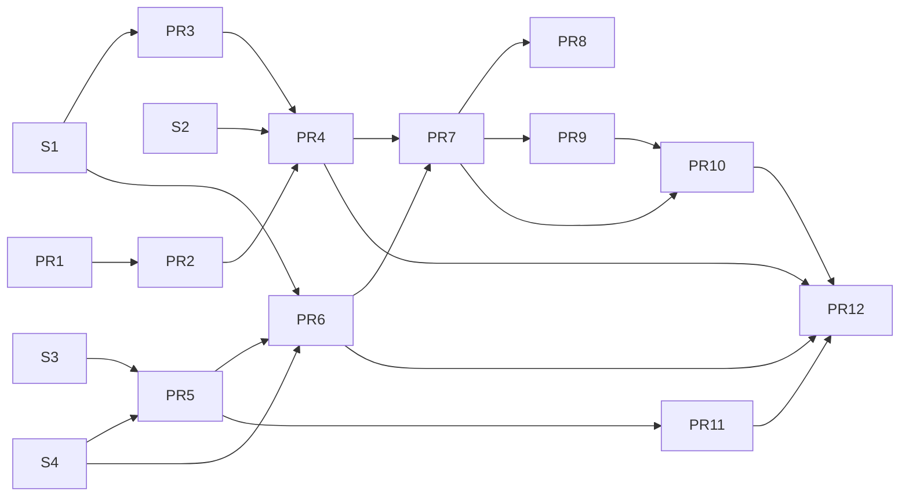

# Feature roadmap: workspace storage backup

Build order for issue
[workspace#102](https://github.com/INTO-CPS-Association/workspace/issues/102)
and the login-relay migration it depends on. Design:
[storage](design/storage/README.md),
[workspace-admin](design/workspace-admin/README.md) and
[LOGIN_RELAY](design/auth/LOGIN_RELAY.md). Requirements: the
[spec](specs/102-s3-backup.md). Work items: the
[plan](plans/102-s3-backup.md) and [tasks](tasks/102-s3-backup.md).

## Planned work, in order

Every planned pull request, in the order to build it. A pull request
starts only when everything in "Depends on" has merged. Spike tasks
S1 to S4 produce findings, not pull requests.

| Order | Work | Feature | Repository | Depends on |
| :--- | :--- | :--- | :--- | :--- |
| 1 | S1 SeaweedFS and S2 rclone spike (done) | — | workspace | — |
| 2 | S3 GitLab and S4 Keycloak spike | — | workspace | — |
| 3 | PR 1: `admin/backup` refactor, no behaviour change | F1 | workspace | — |
| 4 | PR 2: asset names, writer, live reload, `127.0.0.1`, `cap_drop` | F1 | workspace | PR 1 |
| 5 | PR 3: SeaweedFS in test compose (services added by S1; `ci/` variants and compose test remain) | F2 | workspace | S1 |
| 6 | PR 4: S3 backend, `s3keys`, `rclone` in the image | F2 | workspace | PR 2, PR 3, S2 |
| 7 | PR 5: login-relay profiles and GitLab adapter | F3 | workspace | S3, S4 |
| 8 | PR 6: login-relay exchange, JWKS, bounce | F4 | workspace | PR 5, S1, S4 |
| 9 | PR 11: DTaaS deployments on login-relay | F9 | DTaaS | PR 5 |
| 10 | PR 7: admin login core, session checks, front door, control socket | F5 | workspace | PR 4, PR 6 |
| 11 | PR 8: CLI | F6 | workspace | PR 7 |
| 12 | PR 9: GitLab connection for git | F7 | workspace | PR 7 |
| 13 | PR 10: `/config` page | F8 | workspace | PR 7, PR 9 |
| 14 | PR 12: storage in DTaaS deployments | F10 | DTaaS | PR 4, PR 6, PR 10, PR 11 |

PR numbers follow features; the order column is the build order. PR 11
moves early because it is the riskiest user-facing change and lets the
later pull requests be tried in real deployments.

Two tracks start in parallel: storage (PR 1 to PR 4) and login-relay
(PR 5, PR 6). Deployments (PR 11) follow PR 5. The tracks meet at PR 7.
PR 8 and PR 9 can be built in parallel. PR 12 comes last.

## Features

| Feature | Delivers | Design |
| :--- | :--- | :--- |
| F1 Backup foundation | Backend protocol; free asset names; config writer and live reload; admin on `127.0.0.1`; `NET_RAW` dropped in test compose | [Architecture](design/workspace-admin/ARCHITECTURE.md), [config.toml](design/workspace-admin/CONFIG_FILE.md) |
| F2 S3 storage with static keys | SeaweedFS in test compose; S3 backend; `s3keys` connection and token store; `rclone` in the image | [Storage schemes](design/storage/STORAGE_SCHEMES.md) |
| F3 login-relay identity profiles | Profile interface; GitLab profile with introspection adapter; PKCE; TLS-aware cookies; Oathkeeper cache | [LOGIN_RELAY](design/auth/LOGIN_RELAY.md) |
| F4 login-relay storage endpoints | `/token/exchange` with signing keys and JWKS; callback bounce | [LOGIN_RELAY](design/auth/LOGIN_RELAY.md#api) |
| F5 Admin login core and front door | GitLab and Keycloak connections; session checks via login-relay; storage pass and STS each round; control socket; nginx `auth_request` | [Sign-in](design/workspace-admin/SIGN_IN.md), [Login core](design/workspace-admin/LOGIN_CORE.md) |
| F6 CLI | `asset`, `connect`, `disconnect`, `status` subcommands | [CLI](design/workspace-admin/CLI.md) |
| F7 GitLab connection for git | `GIT_AUTH = "gitlab"`; git credentials via environment; `git ls-remote` check | [Connect storage backends](design/storage/CONNECT_BACKENDS.md) |
| F8 `/config` page | Static page, routes, CSRF, security headers | [`/config` page](design/workspace-admin/CONFIG_PAGE.md) |
| F9 DTaaS deployments on login-relay | Oathkeeper and login-relay replace `traefik-forward-auth` in `server`, `secure-server`, `secure-server_with_integrated-gitlab`, `workspace/keycloak/production` | [LOGIN_RELAY](design/auth/LOGIN_RELAY.md#in-short) |
| F10 Storage in DTaaS deployments | SeaweedFS service; provisioning (bucket, versioning, 365-day lifecycle, IAM trusting login-relay, Keycloak client); variables; operator docs; end-to-end test | [STORAGE_GITLAB](design/storage/STORAGE_GITLAB.md), [STORAGE_KEYCLOAK](design/storage/STORAGE_KEYCLOAK.md) |

## Spike

| Task | Confirms | Status |
| :--- | :--- | :--- |
| S1 SeaweedFS | Versioning, lifecycle on versioned buckets, STS with login-relay as issuer, prefix policy and denies; pin latest stable `>= 4.40` | Done: 4.48; role ARN, signing key, 1-hour sessions and a lifecycle runner differ from the design ([findings](tasks/102-s3-backup.md#s1-seaweedfs)) |
| S2 rclone | `--s3-version-at`, SeaweedFS provider, session tokens, `--skip-links`, `--s3-no-check-bucket`; pin latest stable | Done: v1.75.2; the deletion brake needs `--delete-before` ([findings](tasks/102-s3-backup.md#s2-rclone)) |
| S3 GitLab | PKCE for public applications, exact redirect URIs, `/oauth/token/info` and `/oauth/userinfo` fields, refresh rotation, no ID token on refresh, 2-hour access tokens | In part: Oathkeeper's `.Subject` and `.Extra` confirmed; the GitLab checks are scripted but not run, as GitLab 19.5 needs a 4 GB container ([findings](tasks/102-s3-backup.md#s3-gitlab-in-part)) |
| S4 Keycloak | `KC_HOSTNAME_BACKCHANNEL_DYNAMIC`, offline access with consent, 180-day offline maximum, introspection of `workspace-backup` tokens by login-relay | Done: 26.8.1; `workspace-backup` needs an Audience mapper for login-relay's client, and revoke is not in internal discovery ([findings](tasks/102-s3-backup.md#s4-keycloak)) |

## Principles

1. **Core before clients.** Logic is tested without a user interface;
   the CLI comes before the page.
2. **No behaviour change first.** PR 1 lands alone.
3. **Simplest credentials first.** S3 works with static keys (PR 4)
   before it works with logins (PR 7).
4. **Security prerequisites before production.** The nginx front door
   (PR 7) and the `NET_RAW` drop (PR 2, PR 11) ship before PR 12.
5. **Every pull request leaves `main` working.**

## What each feature leaves usable

| After | A user can | An operator can |
| :--- | :--- | :--- |
| F1 | Add a git asset with any name in `config.toml`; changes apply without restart | — |
| F2 | Back up a folder to S3 with keys placed in `tokens/s3keys.json` | Run SeaweedFS in the test compose |
| F3 | Log in with GitLab or Keycloak through login-relay in the test compose | Choose the profile per deployment |
| F4 | — | Issue storage passes; one redirect URI for all users |
| F5 | Back up to S3 without keys after one login (control socket) | Revoke centrally; rely on the front door |
| F6 | Do all of it from a terminal | Script asset setup |
| F7 | Back up git assets without pasting a token | Revoke GitLab access centrally |
| F8 | Do everything from a web page | — |
| F9 | Log in to any DTaaS deployment through login-relay | Retire `traefik-forward-auth` |
| F10 | Use storage backup in a real DTaaS deployment | Provision with one command; restore by runbook |

## Follow-ups and out of scope

Follow-ups: device flow; internal TLS where `NET_RAW` is needed; cloud
S3 guide (login-relay JWKS on a public HTTPS address, AWS session
tags).

Out of scope: restore through the page or CLI (runbook only); renaming
assets; shared areas between users (an operator policy); SeaweedFS
replication; Kubernetes manifests; splitting `git/sync.py` (920
lines), a separate technical-debt item.

## Pull requests

| PR | Feature | Repository | Content | Tasks |
| :--- | :--- | :--- | :--- | :--- |
| 1 | F1 | workspace | `admin/backup` refactor; git becomes one backend; no behaviour change | T101–T102 |
| 2 | F1 | workspace | Asset names, writer, live reload, `127.0.0.1`, `cap_drop` | T103–T107 |
| 3 | F2 | workspace | SeaweedFS in `workspaces/test/dtaas` compose files | T201 |
| 4 | F2 | workspace | S3 backend, `s3keys`, `rclone` in the image | T202–T206 |
| 5 | F3 | workspace | login-relay profiles, GitLab adapter, PKCE, Oathkeeper cache | T301–T304 |
| 6 | F4 | workspace | login-relay exchange, JWKS, bounce | T401–T403 |
| 7 | F5 | workspace | Admin login core, session checks, front door, control socket | T501–T507 |
| 8 | F6 | workspace | CLI subcommands | T601–T602 |
| 9 | F7 | workspace | GitLab connection for git assets | T701–T702 |
| 10 | F8 | workspace | `/config` page | T801–T803 |
| 11 | F9 | DTaaS | Oathkeeper and login-relay in the four deployments (one PR per deployment if large) | T901–T904 |
| 12 | F10 | DTaaS | Storage provisioning, integration and operator docs | T1001–T1003 |

Mapping to the issue's five pull requests: compose service is PR 3;
git backend refactor is PRs 1 and 2; S3 backend is PR 4; provisioning
is PR 12; secure-server integration is PRs 11 and 12. PRs 5 to 10
(login-relay, connections, CLI, page) are not in the issue.
