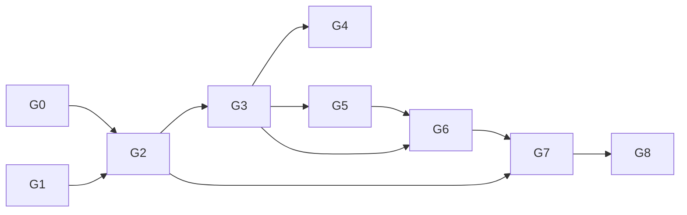

# Feature roadmap: workspace storage backup

Build order for the storage features of issue
[workspace#102](https://github.com/INTO-CPS-Association/workspace/issues/102).
The design is in [design/storage](design/storage/README.md); the
requirements in the [spec](specs/102-s3-backup.md); the work items in
the [plan](plans/102-s3-backup.md) and [tasks](tasks/102-s3-backup.md).

## Principles for the order

1. **Core before clients.** Logic is built and tested without a user
   interface; the CLI comes before the page because it is the thinner
   client and exercises the same core.
2. **No behaviour change first.** The refactor that makes room for a
   second backend lands alone, so a regression has one cause.
3. **Simplest credentials first.** S3 works with static keys before
   it works with Keycloak, so storage and login problems are separate.
4. **Security prerequisites before production.** The front-door fixes
   land with the login core and must ship before the DTaaS deployment.
5. **Every group leaves `main` working.**

## Groups

| Group | Name | Repository | Delivers | Needs |
| :--- | :--- | :--- | :--- | :--- |
| G0 | Spike | both | Pinned SeaweedFS and `rclone`; confirmed OIDC, policy, audience, redirect-URI and token-lifetime behaviour | none |
| G1 | Backup foundation | workspace | Backend protocol, free asset names, config writer, live reload, admin on `127.0.0.1`, `NET_RAW` dropped in test compose | none |
| G2 | S3 storage | workspace | SeaweedFS in test compose; S3 backend with the `s3keys` connection; `rclone` in the image | G0, G1 |
| G3 | Login core, Keycloak connection, front door | workspace | Connections store, PKCE flow, callback, session check, nginx `auth_request` on every path, control socket, STS credentials | G2 |
| G4 | CLI | workspace | `asset`, `connect`, `disconnect`, `status` subcommands | G3 |
| G5 | GitLab connection for git | workspace | `GIT_AUTH = "gitlab"`, owner and repository checks, git credentials via environment | G3 |
| G6 | `/config` page | workspace | Static page, config routes, CSRF and security headers | G3, G5 |
| G7 | Deployment | DTaaS | Provisioning job (bucket, IAM, Keycloak client, GitLab redirect URIs); SeaweedFS, variables and `cap_drop` in the target deployment's compose; operator docs | G2 (provisioning), G6 (end to end) |
| G8 | Follow-ups | both | Device flow; GitLab as STS issuer; session verifier for `traefik-forward-auth` deployments; internal TLS; cloud S3 guide | G7 |

G4 and G5 can be built in parallel. The provisioning half of G7 can
start once G2 lands.

**Deployment target for G7 (open).** The Keycloak connection, the page
and the front-door check need the Oathkeeper and `login-relay` stack
(`workspaces/test/dtaas/compose.traefik.secure.tls.yml`). DTaaS
`secure-server` uses `traefik-forward-auth` with GitLab and has no
Keycloak; `workspace/keycloak/production` uses `traefik-forward-auth`
with Keycloak. G7 must either bring Oathkeeper and `login-relay` into
the chosen DTaaS deployment, or ship only static-key S3 and pasted git
tokens there until G8.

## Pull requests

| PR | Group | Content |
| :--- | :--- | :--- |
| 1 | G1 | `admin/backup` refactor; git becomes one backend; no behaviour change |
| 2 | G1 | Free asset names, `admin/assets` writer, live reload, `127.0.0.1`, `cap_drop` in test compose |
| 3 | G2 | SeaweedFS service in `workspaces/test/dtaas` compose files |
| 4 | G2 | S3 backend, `s3keys` connection, `rclone` in the image |
| 5 | G3 | Login core, Keycloak connection, STS, callback, session check, nginx front door, control socket |
| 6 | G4 | CLI subcommands |
| 7 | G5 | GitLab connection for git assets |
| 8 | G6 | `/config` page |
| 9 | G7 | DTaaS: provisioning job |
| 10 | G7 | DTaaS: deployment integration and operator docs |
| 11+ | G8 | One per follow-up |

PR 3 changes only compose files, so it can be developed in parallel
with PR 1.

### Mapping to the issue's five pull requests

| Issue PR | Here |
| :--- | :--- |
| Compose service | PR 3 |
| Git backend refactor | PR 1 (and PR 2) |
| S3 backend | PR 4 |
| Provisioning | PR 9 |
| Secure-server integration | PR 10 (target deployment open) |
| (not in the issue) | PRs 5 to 8: Keycloak and GitLab connections, CLI, page |

The issue's pull requests were independent; here PR 4 builds on PR 1
because the S3 backend implements the protocol PR 1 introduces.

## What each group leaves usable

| After | A user can | An operator can |
| :--- | :--- | :--- |
| G1 | Add a git asset with any name by editing `config.toml`; changes apply without restart | — |
| G2 | Back up a folder to S3 with keys the operator places in `tokens/s3keys.json` | Run SeaweedFS in the test compose |
| G3 | Back up to S3 without keys after a Keycloak login started over the control socket (integration-tested; G4 makes it convenient) | Revoke a user's backup in Keycloak; rely on the front-door check |
| G4 | Do all of the above from a terminal | Script asset setup |
| G5 | Back up git assets without pasting a token | Revoke GitLab access centrally |
| G6 | Do everything from a web page | — |
| G7 | Use it in a real DTaaS deployment | Provision with one command; restore by runbook |

## Out of scope for this roadmap

- Restore through the page or the CLI (runbook only).
- Renaming assets.
- Shared areas between users (an operator policy, not a feature).
- Replicating SeaweedFS to a second site.
- Kubernetes manifests.
- Splitting `git/sync.py` (920 lines) below the 250-line limit; a
  separate technical-debt item.
