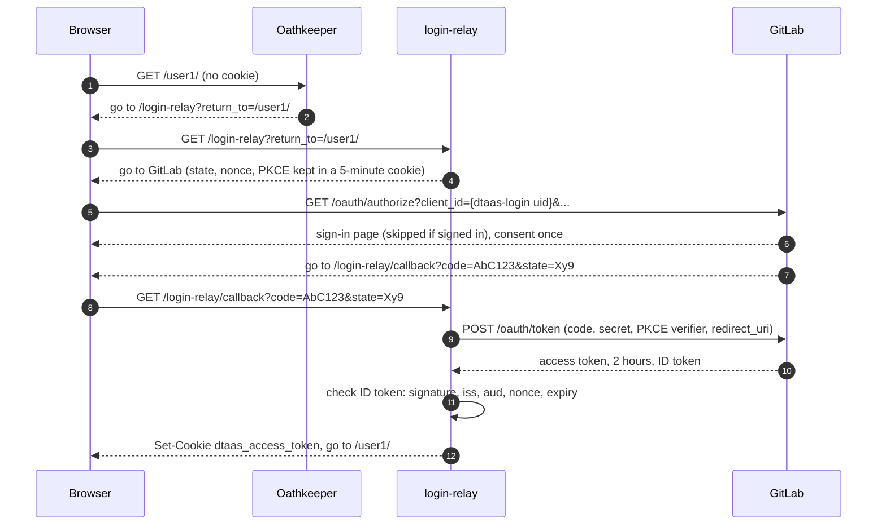
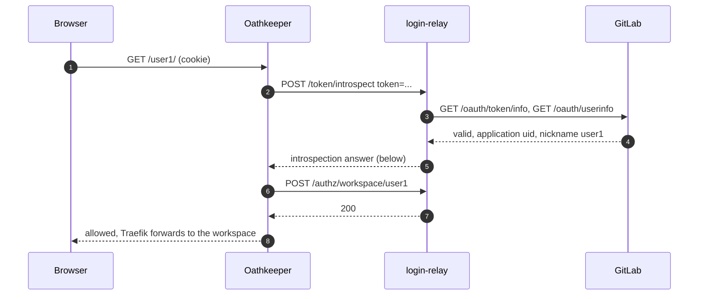
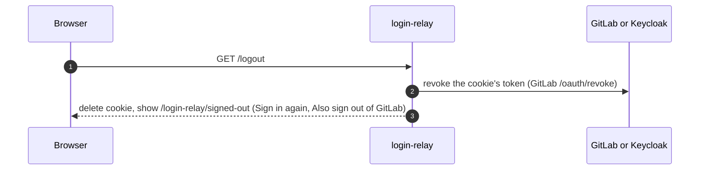

# login-relay

`login-relay` logs users in to DTaaS and answers Oathkeeper's questions
about them. It replaces `traefik-forward-auth` in four DTaaS
deployments and gives workspace backups a storage pass
([STORAGE_GITLAB](../storage/STORAGE_GITLAB.md),
[STORAGE_KEYCLOAK](../storage/STORAGE_KEYCLOAK.md)). Background:
[workspace#59](https://github.com/INTO-CPS-Association/workspace/issues/59).

## In short

Think of DTaaS as a building. **Oathkeeper** is the guard at every
door: it asks each visitor for a pass and checks it, but never issues
one. **login-relay** is the receptionist: it sends visitors to the
identity provider (GitLab or Keycloak) to prove who they are, hands
them a pass (a cookie), and tells the guard whether a pass is still
good. **workspace-admin**, in each user's room, runs the backups.

| Deployment | Identity provider (`IDENTITY_PROVIDER`) | TLS |
| :--- | :--- | :--- |
| `dtaas/docker/server` | `gitlab`, external | No, test only |
| `dtaas/docker/secure-server` | `gitlab`, external | Yes |
| `dtaas/docker/secure-server_with_integrated-gitlab` | `gitlab`, in the stack | Yes |
| `workspace/keycloak/production` | `keycloak` | Yes |

GitLab deployments use GitLab directly. Traefik sends every request to
Oathkeeper first (omitted in diagrams). Examples use
`https://dtaas.example.org`, `https://gitlab.example.org`, `user1`;
workspace-admin's own sign-in is in
[Sign-in](../workspace-admin/SIGN_IN.md).

## Step 1: logging in

user1 opens their workspace. The guard finds no pass and sends them to
reception; reception sends them to GitLab; GitLab sends them back with
a one-time code; reception swaps the code for a pass.



Browser addresses, in order:

1. `https://dtaas.example.org/user1/`
2. `https://dtaas.example.org/login-relay?return_to=https://dtaas.example.org/user1/`
3. `https://gitlab.example.org/oauth/authorize?client_id=<dtaas-login uid>&redirect_uri=https://dtaas.example.org/login-relay/callback&response_type=code&scope=openid&state=Xy9&nonce=Nn4&code_challenge=Qm1...&code_challenge_method=S256`
4. `https://dtaas.example.org/login-relay/callback?code=AbC123&state=Xy9`
5. `https://dtaas.example.org/user1/`, now with the cookie

GitLab application ids are random uids. With Keycloak the steps are
the same against `<realm>/protocol/openid-connect/auth`.

| Failure | Result |
| :--- | :--- |
| `state` cookie missing, expired or different | 400 "Start again"; nothing stored |
| User declines consent | Provider returns `error=access_denied`; page "Login cancelled" |
| ID token invalid (signature, `iss`, `aud`, `nonce`, expiry) | 401; no cookie |
| Account not in `WORKSPACE_USERS` | 403 page "Not a DTaaS user of this deployment"; no cookie |
| Provider unreachable | 502 page "Login service unavailable" |

## Step 2: every later request

The guard asks reception about the pass. Reception checks it with
GitLab, then confirms the room is user1's own.



Oathkeeper caches the answer for 30 seconds. GitLab has no standard
introspection endpoint, so login-relay asks the two questions GitLab
answers and replies in RFC 7662 form; with Keycloak it forwards to
Keycloak's introspection endpoint and applies the same checks.

| Situation | Result |
| :--- | :--- |
| user1 opens `/user2/` | `/authz/workspace/user2` answers 403 |
| Token revoked at the provider | Within 30 seconds the check fails; Step 1 again |
| Account not in `WORKSPACE_USERS` | `active: false` |
| Pass expired (2 hours GitLab, 5 minutes Keycloak) | Step 1 again, usually without a password |
| Provider unreachable | login-relay answers 502; Oathkeeper fails the request and redirects to login, which shows the 502 page |

## Step 3: logging out

Reception tears up the pass and shows a "signed out" page instead of
sending the user back in, which the provider's session would allow.



"Also sign out of GitLab" links to
`https://gitlab.example.org/users/sign_out`; GitLab has no logout for
client applications. With Keycloak, step 2 redirects through
Keycloak's end-session endpoint to the same page. A failed revocation
is logged and the cookie still deleted. Backups are unaffected: they
use workspace-admin's own grant.

## Requirements

- **LR-1** One image; `IDENTITY_PROVIDER = gitlab | keycloak`.
- **LR-2** Login by authorization code with PKCE (S256), `state` and
  `nonce`, as a confidential client. No `prompt` parameter by default;
  `LOGIN_PROMPT` may set one (for example `login`).
- **LR-3** Validate the ID token (signature, `iss`, `aud`, `nonce`,
  expiry) before setting the cookie; for GitLab, `iss` is `GITLAB_URL`,
  keys come from `GITLAB_INTERNAL_URL/oauth/discovery/keys`.
- **LR-4** Cookies `dtaas_access_token`, `oauth_state`: `HttpOnly`,
  `SameSite=Lax`, `Secure` exactly when `TLS=true`.
- **LR-5** `/token/introspect` answers the contract below: `active:
  true` only for a live token of a client in `INTROSPECT_CLIENT_IDS`
  (login and website clients) whose user is in `WORKSPACE_USERS`.
- **LR-6** `/authz/workspace/<user>` allows only that user (as today).
- **LR-7** `/token/exchange` turns a live token of `BACKUP_CLIENT_ID`
  for a listed user into a 5-minute ES256 JWT; it answers 503 when no
  signing key is configured.
- **LR-8** `/login-relay/oauth/<provider>/callback` (`gitlab` or
  `keycloak`) bounces to `/<user>/config/callback/<provider>` when
  `state` matches `^([a-z0-9._-]{1,255})\.([A-Za-z0-9_-]{43})$` (split on
  the last dot) and the user is in `WORKSPACE_USERS`. It never redeems
  the code. It passes the query on unchanged: Keycloak adds `iss`
  (RFC 9207), and its refusals arrive as `error` and
  `error_description` with `state` but no `code`.
- **LR-9** `/token/*`, `/authz/*`, `/.well-known/*` and `/health` are
  not routed by Traefik, which routes only `/login-relay` and `/logout`.
- **LR-10** No token, code or secret in logs or error bodies (request
  logs omit query strings). Provider calls time out after 10 seconds;
  failures answer 502 or `active: false`, never "allow".

## API

| Method and path | Caller | Exposure |
| :--- | :--- | :--- |
| `GET /login-relay?return_to=`, `/login-relay/callback`, `/login-relay/oauth/<provider>/callback` | Browser | Public |
| `GET /logout`, `/login-relay/logout`, `/login-relay/signed-out` | Browser | Public |
| `POST /token/introspect`, `/authz/workspace/<user>` | Oathkeeper, workspace-admin | Internal |
| `POST /token/exchange` | workspace-admin | Internal |
| `GET /.well-known/jwks.json`, `/.well-known/openid-configuration`, `/health` | SeaweedFS, healthcheck | Internal |

**Introspection answer** (both profiles):

```json
{"active": true, "username": "user1", "sub": "42",
 "client_id": "<dtaas-login uid>", "scope": "openid",
 "exp": 1792238150, "token_type": "Bearer", "ext": {"groups": ["dtaas"]}}
```

GitLab: `sub` is `resource_owner_id`, `exp` is now plus `expires_in`,
`username` is `nickname`. Otherwise `{"active": false}`.

Oathkeeper's `.Subject` is `sub`, not `username`. `.Extra` holds
`username`, `client_id`, `scope` and the members of `ext` (so `groups`
is `.Extra.groups`); `exp` and `token_type` do not reach it (spike
S3). The `/authz/workspace/<user>` check therefore reads
`extra.username`, as it does today, and `X-User-Subject` carries the
provider's user id.

**Exchange** (RFC 8693 shape):

```http
POST /token/exchange HTTP/1.1
Host: login-relay:8080
Content-Type: application/x-www-form-urlencoded

grant_type=urn:ietf:params:oauth:grant-type:token-exchange&subject_token=<access token>&subject_token_type=urn:ietf:params:oauth:token-type:access_token
```

Answer `{"access_token": "<JWT>", "issued_token_type":
"urn:ietf:params:oauth:token-type:jwt", "token_type": "Bearer",
"expires_in": 300}`. JWT claims: `iss` `http://login-relay:8080`, `aud`
`workspace-backup`, `sub` and `preferred_username` the user, `iat`,
`exp`. Refusals answer `400 {"error": "invalid_grant"}`.

## Design

| Module | Responsibility |
| :--- | :--- |
| `main.py` | Routes only |
| `_config.py` | Environment, with the compatibility rules below |
| `profiles/base.py` | `Profile`: `authorize_url`, `redeem`, `validate_id_token`, `introspect`, `revoke`, `logout_url` |
| `profiles/keycloak.py`, `profiles/gitlab.py` | Provider behaviour; today's Keycloak code moves out of `_helpers.py` (265 lines), which shrinks |
| `exchange.py` | Token exchange, signing, JWKS |
| `bounce.py` | `state` parsing and redirect |

| Variable | Purpose |
| :--- | :--- |
| `IDENTITY_PROVIDER` | `gitlab` or `keycloak` (default `keycloak`, today's behaviour) |
| `GITLAB_URL`, `GITLAB_INTERNAL_URL` | Public GitLab; address for server calls (default public; `http://gitlab/gitlab` when integrated) |
| `LOGIN_CLIENT_ID`, `LOGIN_CLIENT_SECRET` | Login client; `KEYCLOAK_CLIENT_ID`/`_SECRET` accepted as aliases |
| `INTROSPECT_CLIENT_IDS` | Clients whose tokens count as sessions; default `LOGIN_CLIENT_ID` |
| `BACKUP_CLIENT_ID` | The `workspace-backup` client or application uid |
| `SIGNING_KEY_FILE` | Path to the signing JWK set (Docker secret) |
| `KEYCLOAK_*` URLs and realm, `WORKSPACE_USERS`, `SERVER_DNS`, `TLS`, `OIDC_*` overrides | Unchanged (the overrides serve the Dex CI stack) |

**Compatibility.** Unchanged compose files keep working: Keycloak is
the default profile, old names are aliases, only the active profile's
secret is required, and the `OIDC_*` overrides and CI stacks stay.

**Signing key.** A JWK set of ES256 private keys with `kid` (such as
`2026-10`); the first signs, all public halves are published. A
one-shot service generates it in the test compose (F4) and at DTaaS
setup (F9); without it, exchange answers 503. Rotation: publish the
new key and move it first at once; SeaweedFS fetches the JWKS again
when it meets an unknown `kid` (S1). A removed key stays trusted until
SeaweedFS's `jwksCacheTTLSeconds` (3600) runs out; to cut off a leaked
key at once, restart SeaweedFS after removing it. Passes need a `kid`
header and a `sub` claim.

## Implementation notes

- `_build_auth_params` today sends no PKCE or `nonce` and forces
  `prompt=login`; both profiles change. The verifier and nonce join the
  existing nonce in the `oauth_state` cookie.
- `_active_username` decodes the cookie as a JWT; the cross-user check
  calls `profile.introspect` instead, as GitLab tokens are opaque.
  Oathkeeper gets `cache: {enabled: true, ttl: 30s}` on
  `oauth2_introspection`, which `gitlab.com` rate limits require.
- `authlib` (a dependency already) signs ES256; `pytest-cov` joins
  `requirements-dev.txt`; Keycloak gets
  `KC_HOSTNAME_BACKCHANNEL_DYNAMIC=true`, and `workspace-backup` gets
  an Audience mapper for `dtaas-workspace`, without which Keycloak
  answers login-relay's introspection with `active: false`.
- Tests: Keycloak profile against a container; GitLab profile against
  a fake plus contract tests replaying spike S3 responses; `redeem`
  sends the authorize `redirect_uri`; signed-out page; bounce and
  exchange refusals; internal routes unreachable through Traefik.
