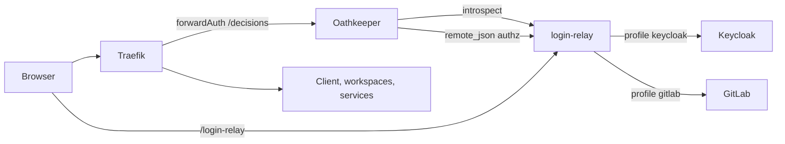

# Replacing traefik-forward-auth with login-relay and Oathkeeper

Design for "Route B": `login-relay` and Oathkeeper authenticate users
directly against the deployment's identity provider, GitLab or
Keycloak, with no Keycloak added to GitLab deployments. Its effect on
workspace storage is in
[storage design 8](../storage/08-route-b-impact.md).

## Scope

DTaaS deployments in
[`deploy/`](https://github.com/INTO-CPS-Association/DTaaS/tree/feature/distributed-demo/deploy)
that use `thomseddon/traefik-forward-auth` today:

| Deployment | Identity provider | TLS | GitLab address |
| :--- | :--- | :--- | :--- |
| `dtaas/docker/server` | External GitLab | No | Public only |
| `dtaas/docker/secure-server` | External GitLab | Yes | Public only |
| `dtaas/docker/secure-server_with_integrated-gitlab` | GitLab in the stack | Yes | Public for browsers, `http://gitlab/gitlab` inside |
| `workspace/keycloak/production` | Keycloak | Yes | n/a |

`dtaas/docker/localhost` has no authentication and is out of scope.

## Target architecture



The pieces and their wiring are those of
`workspaces/test/dtaas/compose.traefik.secure.tls.yml`, which today
supports Keycloak only. Route B adds a **provider profile** to
`login-relay`, so the same image serves both identity providers. Nothing
else in the request path learns which provider is behind it.

## Provider profiles in login-relay

`IDP_PROFILE = keycloak | gitlab` selects the profile.

| Concern | `keycloak` (today) | `gitlab` (new) |
| :--- | :--- | :--- |
| Client | Confidential `dtaas-workspace` | Confidential GitLab application `dtaas-login`, scopes `openid read_user` |
| Endpoints | Discovery on the internal URL; public authorize URL | `/oauth/authorize` (public); `/oauth/token`, `/oauth/userinfo`, `/oauth/token/info`, `/oauth/discovery/keys` on `GITLAB_INTERNAL_URL` (defaults to the public URL) |
| ID token check at login | JWKS, `iss`, `aud` | Same, with GitLab's JWKS and `iss` = GitLab URL |
| Cookie `dtaas_access_token` | Keycloak JWT, 5 minutes | GitLab opaque token, 2 hours |
| Introspection for Oathkeeper | Proxy to Keycloak's RFC 7662 endpoint | **Adapter**: GitLab has no RFC 7662 endpoint, so `/token/introspect` calls `/oauth/token/info` and `/oauth/userinfo` and answers in RFC 7662 form |
| Username | `preferred_username` from the JWT | `nickname` from `userinfo`, returned as `username` by the adapter |
| Cross-user redirect check | Decodes the JWT | Uses the adapter's result (the token is opaque) |
| Logout | Keycloak end-session endpoint | Delete the cookie and revoke the token at `/oauth/revoke`; the GitLab session stays, as GitLab has no logout endpoint for clients |

### The introspection adapter

```text
POST /token/introspect  token=<opaque GitLab token>
  GET  /oauth/token/info      (Authorization: Bearer <token>)
       -> application.uid, scope, expires_in, resource_owner_id
  GET  /oauth/userinfo        (Authorization: Bearer <token>)
       -> sub, nickname
  answer {"active": true, "sub": ..., "username": <nickname>,
          "client_id": <application.uid>, "scope": ..., "exp": ...}
```

The adapter answers `{"active": false}` when GitLab rejects the token,
when `application.uid` is not `dtaas-login`'s id, or when `nickname`
is not in `WORKSPACE_USERS`. Every check is live, so a token revoked in
GitLab stops working at the next uncached request.

### Oathkeeper

Rules and the `remote_json` authorizer stay as they are; the
authorizer already reads `extra.username` before
`extra.preferred_username`. One change: enable Oathkeeper's
introspection cache (TTL 30 seconds). Without it every request would
cost two GitLab API calls, which `gitlab.com`'s rate limits would not
tolerate.

## Per-deployment changes

| Deployment | Changes |
| :--- | :--- |
| `server` | Remove `traefik-forward-auth`; add `oathkeeper` and `login-relay` (`IDP_PROFILE=gitlab`, `TLS=false`); `login-relay` sets `Secure` cookies only when `TLS=true`. Documented as test-only: session cookies cross the network unencrypted |
| `secure-server` | As `server`, with `TLS=true` |
| `secure-server_with_integrated-gitlab` | As `secure-server`, plus `GITLAB_INTERNAL_URL=http://gitlab/gitlab`; the `dtaas-login` application is created when the bundled GitLab is set up |
| `workspace/keycloak/production` | Replace `traefik-forward-auth` with the Keycloak profile as in the workspace TLS compose; add `KC_HOSTNAME_BACKCHANNEL_DYNAMIC=true` so containers use `http://keycloak:8080/auth` while tokens keep the public issuer |

Common to all four:

- Traefik routers use the `oathkeeper-auth` forwardAuth middleware
  instead of the forward-auth one.
- Oathkeeper access rules, one per user, are generated from the
  deployment's user list, as the workspace compose does now.
- `/token/introspect` and `/authz/...` stay internal: Traefik routes
  only `/login-relay` and `/logout` to `login-relay`.

## Operator tasks per identity provider

| Task | GitLab | Keycloak |
| :--- | :--- | :--- |
| Register the login client | GitLab application `dtaas-login`: confidential, scopes `openid read_user`, callback `https://<server>/login-relay/callback` | Client `dtaas-workspace` as today |
| Users | GitLab accounts whose usernames are listed in `WORKSPACE_USERS` | Realm users |
| Revoke a user | Remove from `WORKSPACE_USERS`, or block in GitLab | Disable in Keycloak |

## Risks

| Risk | Mitigation |
| :--- | :--- |
| GitLab API rate limits (`gitlab.com`) | Oathkeeper introspection cache; GitLab tokens last 2 hours, so logins are rare |
| Revocation latency | At most the cache TTL (30 seconds) |
| GitLab login session outlives DTaaS logout | Documented; DTaaS logout revokes the DTaaS token |
| `nickname` and `WORKSPACE_USERS` differ in case | Compare exactly; document that DTaaS usernames are GitLab usernames |
| Two profiles to maintain in `login-relay` | Profile modules behind one interface; both tested in CI, Keycloak against a container, GitLab against a fake |

## Work items

1. `login-relay`: profile interface; GitLab profile; introspection
   adapter; TLS-aware cookies; tests (workspace repo).
2. Oathkeeper: introspection cache (workspace repo).
3. Compose changes for the four deployments, and their docs (DTaaS
   repo).
4. Keycloak `KC_HOSTNAME_BACKCHANNEL_DYNAMIC` in
   `workspace/keycloak/production`, checked by the storage spike
   (T004).

These land as roadmap track A
([storage design 8](../storage/08-route-b-impact.md#roadmap)).
