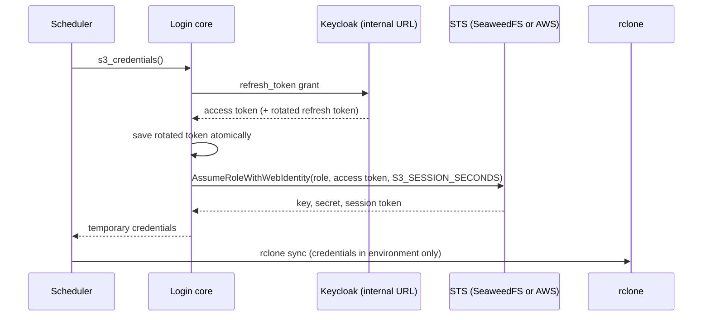

# 3. Connect storage backends

Part of the [storage design](README.md). A **connection** is a stored
credential that one or more assets use. This document defines the
connections, which asset uses which, their life cycle, and the status
kinds. The token types are in [OIDC security](02-oidc-security.md).

## Connections

A workspace has at most one connection of each kind:

| Connection | Credential stored | Used by | Created by |
| :--- | :--- | :--- | :--- |
| `keycloak` | Keycloak offline refresh token | S3 assets when `S3_AUTH = "oidc"` (default) | Browser login with PKCE |
| `s3keys` | Static access key and secret | S3 assets when `S3_AUTH = "keys"` | Page form, CLI prompt, or a file written by the operator |
| `gitlab` | GitLab refresh token | Git assets with `GIT_AUTH = "gitlab"` | Browser login with PKCE |
| (none) | `GIT_REPO_TOKEN` in the asset's section | Git assets with `GIT_AUTH = "token"` (default) | `config.toml`, page or CLI |

`S3_AUTH` is deployment-wide; `GIT_AUTH` is per asset. Ten S3 assets
need one Keycloak login, not ten. `s3keys` is for S3 services without
web-identity STS and for tests; the default deployment issues no
per-user keys.

Connections live in `$PERSISTENT_DIR/.config/workspace-admin/tokens/`,
one file per connection (`keycloak.json`, `gitlab.json`,
`s3keys.json`), mode `0600`. That folder is excluded from every backup
and ignored by git, as `config.toml` already is. New features put no
secret in `config.toml`; only the pasted git token stays there.

```json
{"provider": "keycloak", "subject": "user1",
 "obtained_at": "2026-10-17T09:00:00Z",
 "secret": {"refresh_token": "..."}}
```

## Credentials per round

Every round obtains fresh credentials once and shares them across the
round's assets. Nothing is cached between rounds, so a revoked grant
shows as `login_expired` in the next round.

### S3 with the `keycloak` connection



STS checks the token's signature against Keycloak's signing keys, its
issuer, audience (`workspace-backup`) and expiry, and the role's trust
policy. The role's policy limits the credentials to
`<bucket>/${jwt:preferred_username}/*`. Credentials already handed to
`rclone` stay valid until they expire (up to `S3_SESSION_SECONDS`);
that is the revocation latency for a round in progress.

### S3 with the `s3keys` connection

The stored pair goes straight to `rclone`. No STS, no refresh.

### Git with the `gitlab` connection

Each round with git assets refreshes the GitLab access token. Git
receives it as Basic `oauth2:<access token>`. From roadmap G5 on, all
git credentials, pasted or connected, reach git through the
`GIT_CONFIG_COUNT`, `GIT_CONFIG_KEY_n` and `GIT_CONFIG_VALUE_n`
environment variables instead of `-c http.extraHeader=...` arguments,
so they no longer appear in process listings.

### Git with a pasted token

Unchanged in meaning: `GIT_REPO_TOKEN` from the asset's section. It is
fully supported alongside the GitLab connection. The page recommends a
project access token with only `write_repository` and a protected
branch.

## Life cycle

| Step | What happens | Status afterwards |
| :--- | :--- | :--- |
| Not connected | Assets needing the connection are skipped | `not_connected` |
| Connect | Login, owner check, store | next round decides |
| Use | Each round refreshes; rotated tokens saved first | per round |
| Expired or revoked | Provider answers `invalid_grant` | `login_expired`; page offers Reconnect |
| Reconnect | Same as connect; replaces the file | |
| Disconnect | Revoke at the provider, then delete the file; a failed revoke is logged and the file still deleted | `not_connected` |

A connection is independent of assets: removing the last asset that
uses it does not disconnect it.

## Status

`/storage/status` stays read-only and secret-free and needs no admin
session; from G3 on it passes the nginx session check like every path
except `/ping`. It keeps
today's fields and adds `s3` and `connections` only when they are
used:

```json
{"enabled": true,
 "repositories": {"thesis": {"last_attempt": "...", "last_success": "...",
                             "last_error": null}},
 "s3": {"models": {"last_attempt": "...", "last_success": "...",
                   "last_error": {"kind": "login_expired", "at": "..."}}},
 "connections": {"keycloak": "connected", "gitlab": "not_connected"}}
```

Without S3 assets, connections or GitLab-connected git assets, the
response is byte-identical to today's. Connection states are
`connected`, `not_connected` and `expired`.

### Status kinds

This table is the single list of new kinds; other documents refer to
it. Existing git kinds are unchanged.

| Kind | Raised when |
| :--- | :--- |
| `not_connected` | The asset needs a connection that does not exist |
| `login_expired` | The provider rejected the refresh token |
| `login_unreachable` | Keycloak or GitLab could not be reached |
| `repo_unreachable` | `git ls-remote` fails with a new GitLab connection |
| `s3_not_configured` | An S3 asset exists but `S3_ENDPOINT` is not set |
| `s3_auth_failed` | STS refused the token, or S3 refused the credentials |
| `s3_unreachable` | STS or S3 could not be reached |
| `s3_bucket_missing` | The bucket does not exist |
| `s3_versioning_disabled` | Versioning is not `Enabled` |
| `s3_empty_source` | The asset folder is missing or empty |
| `s3_delete_limit` | The round would delete more than `S3_MAX_DELETE` objects |
| `s3_timeout` | `rclone` exceeded its time limit |
| `s3_failed` | Any other `rclone` failure |

Login-core errors map onto these: `provider_unreachable` becomes
`login_unreachable` for Keycloak or GitLab and `s3_unreachable` for
STS, `login_expired` stays, `sts_denied` becomes
`s3_auth_failed`. A rejected GitLab token during a push keeps today's
`auth_failed`.

## Concurrency

- The scheduler thread and the `/config` handlers both use
  connections. A lock per provider serialises refresh, replacement and
  deletion, so a disconnect cannot race a refresh that would write the
  old token back.
- A connect that completes during a round takes effect next round.
- Each connect gets its own `state`. Two tabs connecting at once both
  succeed; the later one replaces the earlier connection.

## Deployment-wide settings

Set once per deployment in the workspace containers' environment
(compose today, a ConfigMap on Kubernetes). All values are public.

| Variable | Purpose |
| :--- | :--- |
| `PUBLIC_BASE_URL` | Scheme and host users see, for example `https://dtaas.example.org`; builds redirect URIs and the expected `Origin` |
| `S3_ENDPOINT`, `S3_REGION`, `S3_BUCKET`, `S3_PROVIDER` | Where S3 assets go; without `S3_ENDPOINT` the page offers no S3 |
| `S3_AUTH` | `oidc` (default) or `keys` |
| `S3_STS_ENDPOINT`, `S3_ROLE_ARN`, `S3_SESSION_SECONDS` | STS exchange; session default 3600 |
| `S3_MAX_DELETE` | Deletion brake per round; default 1000 |
| `OIDC_ISSUER` | Keycloak realm's public URL (the `iss` in tokens) |
| `OIDC_INTERNAL_URL` | Keycloak realm's address inside the network, used for token, userinfo and revoke calls; defaults to `OIDC_ISSUER` |
| `OIDC_CLIENT_ID` | `workspace-backup` |
| `DTAAS_LOGIN_CLIENT_ID` | `login-relay`'s client (`dtaas-workspace`), the expected `azp` of session cookies |
| `GITLAB_URL`, `GITLAB_CLIENT_ID` | GitLab and its `workspace-backup` application; without them no GitLab connection is offered |
| `GITLAB_OWNER_CHECK` | `username` (default) or `confirm` |
| `SSL_CERT_FILE` | Extra CA bundle when the deployment uses a private CA (standard library behaviour) |
