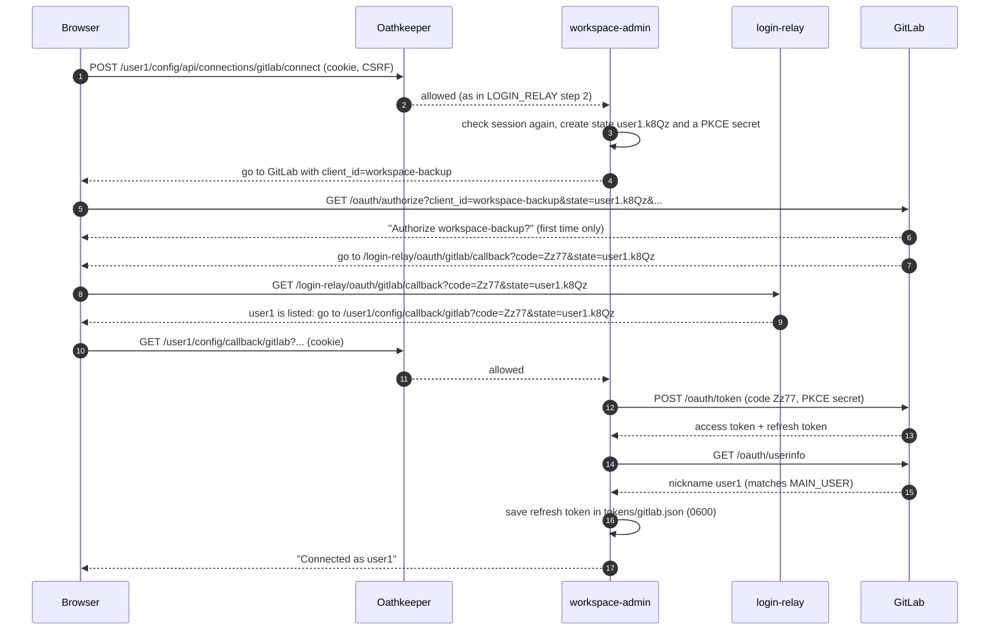
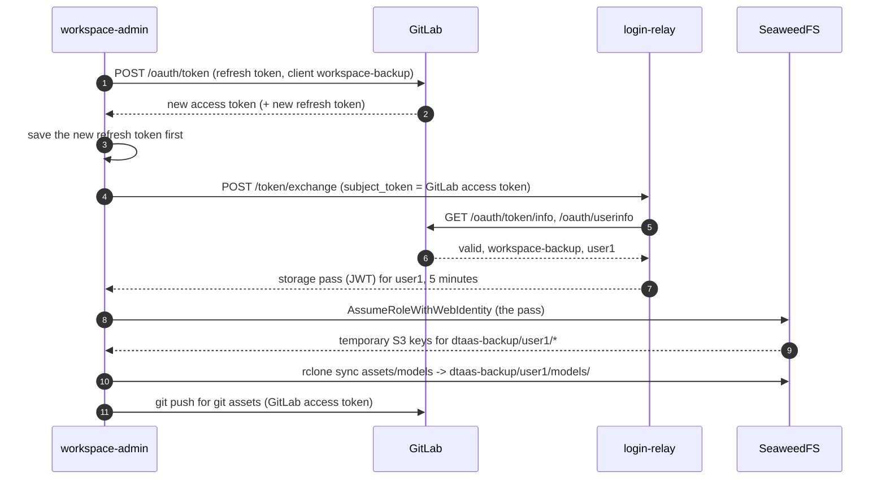

# Storage in GitLab deployments

How workspace backups connect and run in `dtaas/docker/server`,
`secure-server` and `secure-server_with_integrated-gitlab`, where users
log in with GitLab directly. Login itself is in
[LOGIN_RELAY](../auth/LOGIN_RELAY.md); the Keycloak deployment is in
[STORAGE_KEYCLOAK](STORAGE_KEYCLOAK.md). Part of the
[storage design](README.md).

## In short

1. user1 logs in to DTaaS with GitLab ([LOGIN_RELAY](../auth/LOGIN_RELAY.md)).
2. On `https://dtaas.example.org/user1/config`, user1 adds assets and
   clicks **Connect with GitLab** once.
3. Every five minutes, workspace-admin refreshes that grant, swaps it
   at login-relay for a 5-minute storage pass, trades the pass at
   SeaweedFS for temporary S3 keys, and syncs. Git assets push with the
   same GitLab token.

One GitLab grant serves both S3 and git. Nobody pastes a key or token.
In the building picture of [LOGIN_RELAY](../auth/LOGIN_RELAY.md#in-short),
workspace-admin gets its own long-term key from GitLab once, and every
five minutes asks reception for a short storage pass that the storage
room (SeaweedFS) accepts.

## GitLab applications

| Application | Used by | Type | Scopes | Returns to |
| :--- | :--- | :--- | :--- | :--- |
| `dtaas-client` | DTaaS website | as today | as today | the website |
| `dtaas-login` | login-relay | Confidential | `openid` | `https://dtaas.example.org/login-relay/callback` |
| `workspace-backup` | workspace-admin | Public, PKCE | `openid write_repository` | `https://dtaas.example.org/login-relay/oauth/gitlab/callback` |

The login pass can never push to git; the long-lived backup grant is
never a browser cookie. Each application is approved once per user.

## Step 4: connecting backups

user1 adds asset `models` on S3 and clicks **Connect with GitLab**.



Browser addresses:

1. `https://dtaas.example.org/user1/config`
2. `https://gitlab.example.org/oauth/authorize?client_id=<workspace-backup id>&redirect_uri=https://dtaas.example.org/login-relay/oauth/gitlab/callback&response_type=code&scope=openid%20write_repository&state=user1.k8Qz&code_challenge=...&code_challenge_method=S256`
3. `https://dtaas.example.org/login-relay/oauth/gitlab/callback?code=Zz77&state=user1.k8Qz`
4. `https://dtaas.example.org/user1/config/callback/gitlab?code=Zz77&state=user1.k8Qz`
5. `https://dtaas.example.org/user1/config#connected`

**Why the bounce (steps 8 and 9).** GitLab only returns to registered
addresses. One shared address at login-relay, which reads the user
from `state`, means adding a user never changes the GitLab
application. login-relay only redirects; the code is redeemed by
workspace-admin, which alone holds the PKCE secret.

From a terminal, `workspace-admin connect gitlab` starts the same flow
over the control socket, prints address 2, and waits for step 17.

## Step 5: a backup round

Every five minutes, also when nobody is logged in:



**Why the storage pass (steps 4 to 7).** SeaweedFS accepts only a
signed token naming the user. GitLab tokens are opaque, and a refresh
returns no new ID token, so login-relay checks the GitLab token live
and signs its own short pass. SeaweedFS trusts only login-relay's keys
(`http://login-relay:8080/.well-known/jwks.json`).

All round traffic is internal: `http://login-relay:8080/token/exchange`
and `http://seaweedfs:8333/`, plus GitLab.

If connecting fails:

| Failure | Result |
| :--- | :--- |
| GitLab account is not user1 (`nickname` differs) | Nothing stored; "Log in to GitLab as user1 (you are user2)" |
| Login took longer than 10 minutes, or the link was reused | "Start again" (`state` expired or used) |
| user1 cancels at GitLab | "Not connected" |
| `state` names an unlisted user at the bounce | login-relay answers 403; nothing reaches a workspace |
| GitLab unreachable | "GitLab unavailable, try later" |

## What stops a backup

| Action | Effect | Status |
| :--- | :--- | :--- |
| Operator removes user1 from `WORKSPACE_USERS` | Step 7 refuses | `s3_auth_failed`; git push still uses the token until GitLab blocks it |
| GitLab admin blocks user1, or user1 revokes `workspace-backup` | Step 1 fails | `login_expired` |
| Connection older than `CONNECTION_MAX_AGE_DAYS` (180) | Admin stops using it | `login_expired`; page offers Reconnect |
| user1 clicks Disconnect | Token revoked and deleted | `not_connected` |
| SeaweedFS down | Step 8 fails; git assets continue | `s3_unreachable` |

GitLab refresh tokens never expire on their own, so the 180-day limit
is enforced by workspace-admin.

## Integrated GitLab

GitLab runs at `https://dtaas.example.org/gitlab`. Browser addresses
use that URL. workspace-admin and login-relay call
`http://gitlab/gitlab/oauth/token`, `/oauth/token/info`,
`/oauth/userinfo` and `/oauth/revoke`, and git assets use remotes like
`http://gitlab/gitlab/user1/thesis.git`, set through
`GITLAB_INTERNAL_URL=http://gitlab/gitlab`.

## Configuration

Workspace containers:

```yaml
environment:
  - MAIN_USER=user1
  - PUBLIC_BASE_URL=https://dtaas.example.org
  - IDENTITY_PROVIDER=gitlab
  - GITLAB_URL=https://gitlab.example.org
  - GITLAB_INTERNAL_URL=https://gitlab.example.org   # http://gitlab/gitlab when integrated
  - GITLAB_CLIENT_ID=${WORKSPACE_BACKUP_APP_ID}
  - LOGIN_RELAY_INTERNAL_URL=http://login-relay:8080
  - S3_ENDPOINT=http://seaweedfs:8333
  - S3_BUCKET=dtaas-backup
  - S3_PROVIDER=SeaweedFS
  - S3_STS_ENDPOINT=http://seaweedfs:8333
  - S3_ROLE_ARN=arn:aws:iam::role/WorkspaceBackup
cap_drop: [NET_RAW]
```

SeaweedFS `iam.json` (shape; the full file, checked by spike S1, is
`workspaces/test/dtaas/seaweedfs/iam.json`):

```json
{"providers": [{"name": "login-relay", "type": "oidc",
   "config": {"issuer": "http://login-relay:8080", "clientId": "workspace-backup",
              "jwksUri": "http://login-relay:8080/.well-known/jwks.json"}}],
 "roles": [{"roleName": "WorkspaceBackup",
   "trustPolicy": {"Statement": [{"Effect": "Allow",
     "Principal": {"Federated": "login-relay"},
     "Action": "sts:AssumeRoleWithWebIdentity"}]},
   "attachedPolicies": ["WorkspaceBackupPrefix"]}]}
```

The `WorkspaceBackupPrefix` policy is in the
[threat model](THREAT_MODEL.md#storage-side-hardening).

## Implementation notes

- GitLab application ids are random uids: `GITLAB_CLIENT_ID` (admin) and
  login-relay's `BACKUP_CLIENT_ID` hold the same `workspace-backup` uid.
- Disconnect revokes with `POST /oauth/revoke` sending `token` and
  `client_id` (no secret: the application is public).
- workspace-admin's provider for connections is GitLab
  (`IDENTITY_PROVIDER=gitlab`); the page shows one connection.
- Owner check: `nickname == MAIN_USER`, or confirmation with
  `GITLAB_OWNER_CHECK=confirm`.
- After connecting, each git asset is checked with `git ls-remote`;
  failures report `repo_unreachable` but keep the connection.
- Session checks for `/config` and the nginx front door call
  `http://login-relay:8080/token/introspect` with the cookie's token.
