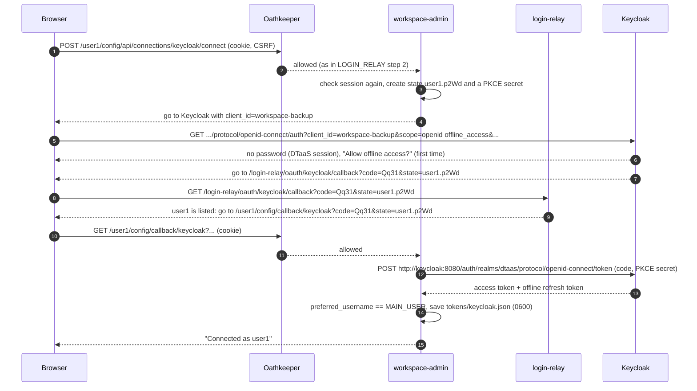
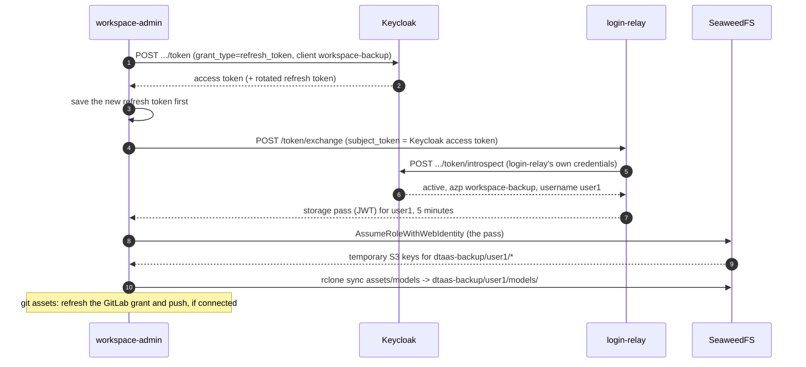

# Storage in the Keycloak deployment

How workspace backups connect and run in `workspace/keycloak/production`,
where users log in with Keycloak. Login itself is in
[LOGIN_RELAY](../auth/LOGIN_RELAY.md); GitLab deployments are in
[STORAGE_GITLAB](STORAGE_GITLAB.md). Part of the
[storage design](README.md).

## In short

1. user1 logs in to DTaaS with Keycloak ([LOGIN_RELAY](../auth/LOGIN_RELAY.md)).
2. On `https://dtaas.example.org/user1/config`, user1 clicks **Connect
   with Keycloak** for S3 assets and, if the deployment has a GitLab for
   git assets, **Connect with GitLab**.
3. Every five minutes, workspace-admin refreshes the Keycloak grant,
   swaps it at login-relay for a 5-minute storage pass, trades the pass
   at SeaweedFS for temporary S3 keys, and syncs. Git assets on a
   GitLab connection push with a fresh GitLab token, as in
   [STORAGE_GITLAB](STORAGE_GITLAB.md#step-5-a-backup-round).

In the building picture of [LOGIN_RELAY](../auth/LOGIN_RELAY.md#in-short),
workspace-admin gets its own long-term key from Keycloak once, and
every five minutes asks reception for a short storage pass.

From the storage pass on, the round is the same as in GitLab
deployments: SeaweedFS trusts only login-relay in both.

## Keycloak clients

| Client | Used by | Type | Scopes | Returns to |
| :--- | :--- | :--- | :--- | :--- |
| `dtaas-workspace` | login-relay | Confidential | `openid profile` | `https://dtaas.example.org/login-relay/callback` |
| `workspace-backup` | workspace-admin | Public, PKCE S256, "Consent required" | `openid offline_access` | `https://dtaas.example.org/login-relay/oauth/keycloak/callback` |

Realm settings: "Offline Session Idle" 30 days, "Offline Session Max
Limited" on with 180 days. Keycloak runs with
`KC_HOSTNAME=https://dtaas.example.org/auth` and
`KC_HOSTNAME_BACKCHANNEL_DYNAMIC=true`, so browsers use the public URL
and containers `http://keycloak:8080/auth`.

Git assets use a GitLab connection when `GITLAB_URL` is set (a
`workspace-backup` application on that GitLab, as in
[STORAGE_GITLAB](STORAGE_GITLAB.md#gitlab-applications)), otherwise
pasted tokens.

## Step 4: connecting S3 backups



Browser addresses:

1. `https://dtaas.example.org/user1/config`
2. `https://dtaas.example.org/auth/realms/dtaas/protocol/openid-connect/auth?client_id=workspace-backup&redirect_uri=https://dtaas.example.org/login-relay/oauth/keycloak/callback&response_type=code&scope=openid%20offline_access&state=user1.p2Wd&code_challenge=...&code_challenge_method=S256`
3. `https://dtaas.example.org/login-relay/oauth/keycloak/callback?code=Qq31&state=user1.p2Wd`
4. `https://dtaas.example.org/user1/config/callback/keycloak?code=Qq31&state=user1.p2Wd`
5. `https://dtaas.example.org/user1/config#connected`

The Keycloak SSO session from logging in to DTaaS means no password;
"Consent required" shows the user what offline access means. The
bounce works as in GitLab deployments: one registered address for all
users.

## Step 5: a backup round



Keycloak tokens are signed JWTs and could go to STS directly. Using
login-relay here too keeps one trust setup in SeaweedFS, one code path
in workspace-admin, and the `WORKSPACE_USERS` switch in both kinds of
deployment.

If connecting fails:

| Failure | Result |
| :--- | :--- |
| Keycloak account is not user1 | Nothing stored; "Log in as user1 (you are user2)" |
| Login took longer than 10 minutes, or the link was reused | "Start again" |
| user1 declines offline access | "Not connected" |
| `state` names an unlisted user at the bounce | login-relay answers 403 |
| Keycloak unreachable | "Keycloak unavailable, try later" |

## What stops a backup

| Action | Effect | Status |
| :--- | :--- | :--- |
| Operator removes user1 from `WORKSPACE_USERS` | Step 7 refuses | `s3_auth_failed` |
| Keycloak admin disables user1 or revokes offline sessions | Step 1 fails | `login_expired` |
| Workspace stopped longer than 30 days, or grant older than 180 days | Step 1 fails | `login_expired`; page offers Reconnect |
| user1 clicks Disconnect | Revoked at Keycloak and deleted | `not_connected` |
| SeaweedFS down | STS or sync fails; git assets continue | `s3_unreachable` |

## Configuration

Workspace containers differ from GitLab deployments in these values:

```yaml
environment:
  - IDENTITY_PROVIDER=keycloak
  - OIDC_ISSUER=https://dtaas.example.org/auth/realms/dtaas
  - OIDC_INTERNAL_URL=http://keycloak:8080/auth/realms/dtaas
  - OIDC_CLIENT_ID=workspace-backup
  - GITLAB_URL=https://gitlab.example.org        # optional, for git assets
  - GITLAB_CLIENT_ID=${WORKSPACE_BACKUP_APP_ID}  # optional
```

`LOGIN_RELAY_INTERNAL_URL`, the S3 settings, `cap_drop` and SeaweedFS's
`iam.json` are as in
[STORAGE_GITLAB](STORAGE_GITLAB.md#configuration).

## Implementation notes

- Two connections on the page: Keycloak (S3) and, when configured,
  GitLab (git).
- Owner check: the access token's `preferred_username == MAIN_USER`
  from the token endpoint's reply; a mismatch names both users.
- The 180-day maximum is Keycloak's "Offline Session Max";
  `CONNECTION_MAX_AGE_DAYS` applies as well, so both profiles behave
  alike.
- Session checks for `/config` and the nginx front door call
  `http://login-relay:8080/token/introspect`, as in GitLab deployments.
