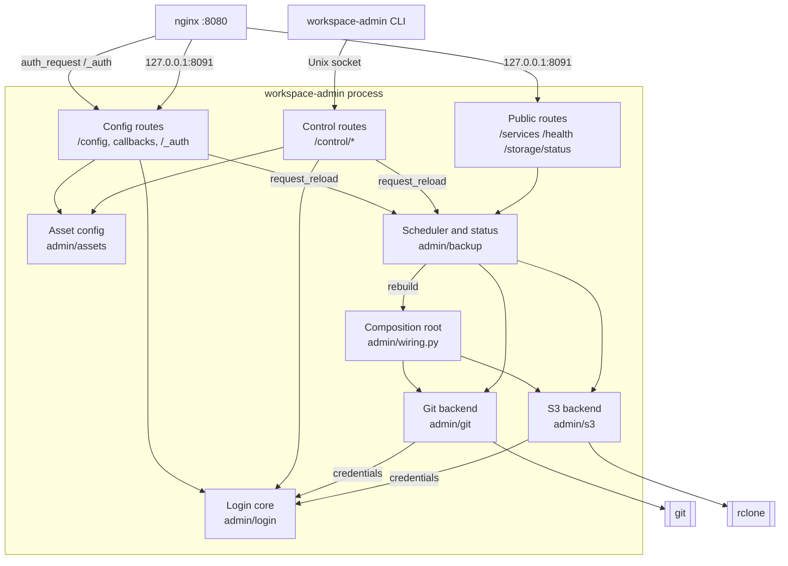

# Complete system design

Part of the [storage design](README.md). Puts the other documents
together: context, components, deployment, behaviour, quality
requirements and decisions.

## System context


## Components inside a workspace



| Package | Owns | Imports |
| :--- | :--- | :--- |
| `admin/shared.py` | `ProviderName`, `OAuthProvider`, `ConnectionState` | nothing |
| `admin/backup` | `Backend` protocol, scheduler, status, error kinds; calls a round hook it is given | `shared` |
| `admin/login` | Connections, flows, session check, storage pass, STS | `shared` |
| `admin/assets` | Parse, validate, write `config.toml` | `backup` (kinds) |
| `admin/git` | Git backend: existing clone, sync, auth | `backup`, `login` |
| `admin/s3` | S3 backend, `rclone` runner, error mapping | `backup`, `login` |
| `admin/wiring.py` | Builds backends from asset config and the round hook; the only module that knows every backend and the login core | `assets`, `git`, `s3`, `backup`, `login` |
| `admin/web` | Config, callback, `/_auth` and control routes; static page | `login`, `assets`, `backup`, `wiring` |
| `admin/cli` | Subcommands; socket client; offline writer fallback | `assets` |
| `admin/api.py` | Public routes (unchanged contract) | `backup` |

The dependency graph has no cycle: `backup` and `login` sit at the
bottom; only `wiring` and `web` see everything.

## Files in a workspace

```text
$PERSISTENT_DIR/
├── assets/<name>/                         backed-up folders
├── .config/workspace-admin/               never backed up
│   ├── config.toml                        0600
│   ├── .gitignore                         "*"
│   └── tokens/{keycloak,gitlab,s3keys}.json   0600
└── .local/share/workspace-admin/<name>/   git directories
/tmp/workspace-admin-<uid>/control.sock    directory 0700
```

## Deployment (Docker Compose)

| Service | Networks | Ports | Changes |
| :--- | :--- | :--- | :--- |
| traefik, oathkeeper, login-relay | as today (F9 adds them to every deployment) | as today | login-relay: profile, `/token/exchange`, bounce, signing key secret ([LOGIN_RELAY](../auth/LOGIN_RELAY.md)) |
| keycloak (Keycloak deployment) | as today | as today | `workspace-backup` client: public, PKCE, consent, `offline_access`, bounce redirect URI |
| GitLab (GitLab deployments) | external or in the stack | as today | `dtaas-login` and `workspace-backup` applications |
| `user<N>` workspaces | `users` | none | `cap_drop: [NET_RAW]`; S3, OIDC and GitLab variables; admin on `127.0.0.1`; nginx `auth_request` |
| `seaweedfs` | `users` only | none | `weed server -s3`, `/data` volume, `s3.json`, `iam.json` |
| `storage-provision` | `users` | none | One-shot, profile `provision`: bucket, versioning, lifecycle (`NONCURRENT_VERSION_DAYS`, default 365), IAM files trusting login-relay, Keycloak client |

Admin credentials for SeaweedFS, Keycloak and GitLab exist only in
`storage-provision` and the operator's `.env`; workspaces never get
them. On Kubernetes the same pieces become a StatefulSet, a Job and a
ConfigMap; that port is out of scope here.

## Behaviour

### Startup

1. Parse arguments. Create the control-socket directory and bind the
   socket; start TCP on `127.0.0.1`.
2. Create `config.toml` from the template if missing (existing
   `provision.py`). Operators may pre-seed assets in the template.
3. Load and validate the asset configuration; `wiring` builds one
   backend per valid asset.
4. On a background thread, `prepare` each backend (clone, bucket
   check) and start the scheduler. HTTP never waits for this.

### A sync round

1. Reload first if `config.toml` changed or a reload was requested.
2. The scheduler calls the round hook that `wiring.py` gave it. The
   hook calls `s3_credentials()` once if any S3 asset exists and
   `gitlab_access_token()` once if any git asset uses GitLab, and hands
   the results to those backends for this round. A failure marks those
   assets with the mapped status kind and skips them; other assets
   continue.
3. Sync each asset; record success or the error kind.
4. Stop between assets when the service is stopping.

### Shutdown

Set the stop event; a running `git` or `rclone` ends within the
existing 8-second limit; pending logins are dropped; the socket is
removed.

## Quality requirements

| Quality | Requirement | How |
| :--- | :--- | :--- |
| Security | Neighbouring workspaces cannot reach a workspace's tools or admin | nginx `auth_request`, `127.0.0.1`, socket directory `0700` |
| Security | No secret in logs, argv, status or page | Write-only fields; credentials via environment for `rclone` and git |
| Security | Configuration changes need the owner's session or socket | Session check, CSRF, socket |
| Reliability | One failing asset or connection never stops others | Per-asset errors and per-section validation |
| Reliability | No data loss from an empty or unmounted folder, or mass deletion | Empty-source refusal, `S3_MAX_DELETE` |
| Availability | Backups run while the page is unused | Credentials refreshed per round |
| Responsiveness | Sync never blocks HTTP | Background thread, as today |
| Portability | Cloud S3 by configuration | Standard protocols only |
| Maintainability | New files under 250 lines, functions under 25; files already over 250 do not grow; pylint 9.0+ | Small modules per concern |
| Dependencies | No new Python runtime dependency; one pinned `rclone` | Standard library HTTP, XML, locking |

## Decisions

| # | Decision | Reason |
| :--- | :--- | :--- |
| D1 | `rclone` for S3 | Sync, excludes and version restore built in |
| D2 | One backend per asset | Git pulls and S3 mirrors conflict on one folder |
| D3 | Free asset names `^[a-z0-9]{1,63}$`, no special names | Sharing is a server policy, not a client choice |
| D4 | Add and remove only | Renaming moves data across folders, prefixes and repositories |
| D5 | One bucket, prefix per user | Bucket limits and cost in clouds; prefix policies suffice |
| D6 | S3 via the deployment's identity provider, git via GitLab | Central revocation, short-lived credentials |
| D7 | GitLab connection alongside pasted tokens | Non-breaking; other git hosts keep working |
| D8 | Browser login with PKCE first; device flow later | Reuses the DTaaS session; works on any GitLab |
| D9 | Admin on `127.0.0.1`; CLI on a Unix socket in a `0700` directory | Nothing that changes configuration is reachable without the owner's session or account |
| D10 | Session check through login-relay's `/token/introspect`, also for nginx | One path for opaque GitLab and JWT Keycloak tokens; no crypto dependency; closes the front door |
| D11 | Hand-editable `config.toml` with version check | Page, CLI and editor coexist; comments lost on machine saves |
| D12 | Provisioning in the DTaaS repository | User list, compose and Keycloak live there |
| D13 | Fresh credentials every round | Revocation takes effect next round |
| D14 | One bounce redirect URI at login-relay for all users | Providers need exact URIs; adding a user must not change the registration |
| D15 | `cap_drop: [NET_RAW]` on workspaces | Internal OAuth and STS traffic is plain HTTP |
| D16 | GitLab deployments use GitLab directly | Decided; no Keycloak added to them |
| D17 | login-relay issues storage passes in both profiles | GitLab gives no signed token on refresh; one STS trust setup |
| D18 | One GitLab grant for S3 and git in GitLab deployments | One click; the S3-only user grants `write_repository` too |
| D19 | Grants end after 180 days; noncurrent versions after 365 days by default | Answers to open questions; both configurable |

## Open questions

None at the design level. Versions follow the latest stable
releases, pinned by the spike tasks S1 to S4 of the
[roadmap](../../FEATURE_ROADMAP.md).
