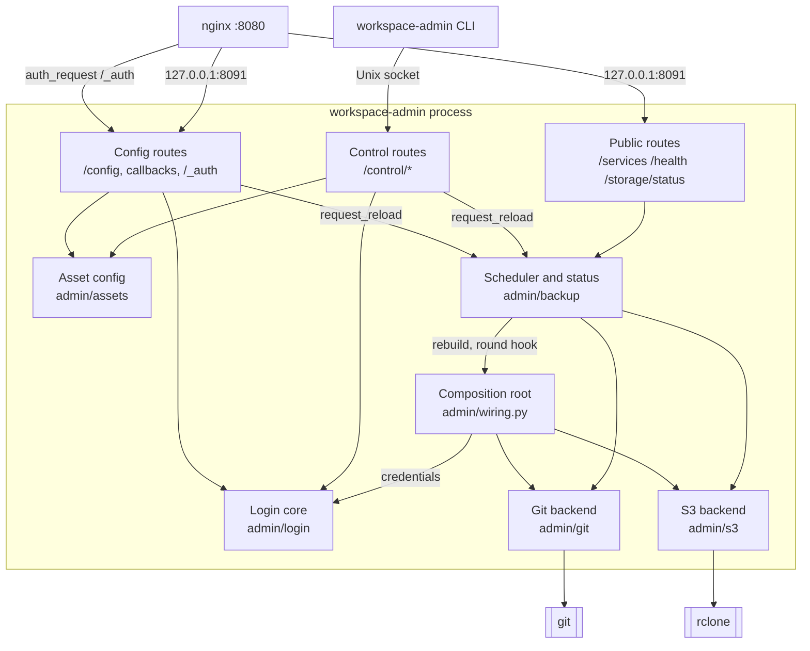

# workspace-admin architecture

Part of the [workspace-admin design](README.md). The packages inside
the `workspace-admin` process, how they depend on each other, the files
and listeners it owns, and how it starts, runs a round and stops. The
system around it is in the
[storage system design](../storage/SYSTEM_DESIGN.md).

## Components



| Package | Owns | Imports |
| :--- | :--- | :--- |
| `admin/shared.py` | `ProviderName`, `OAuthProvider`, `ConnectionState` | nothing |
| `admin/backup` | `Backend` protocol, scheduler, status, error kinds; calls a round hook it is given | `shared` |
| `admin/login` | Connections, sign-in, session check, storage pass, STS ([Login core](LOGIN_CORE.md)) | `shared` |
| `admin/assets` | Parse, validate, write `config.toml` ([Config file](CONFIG_FILE.md)) | `backup` (kinds) |
| `admin/git` | Git backend: existing clone, sync, auth | `backup` |
| `admin/s3` | S3 backend, `rclone` runner, error mapping | `backup` |
| `admin/wiring.py` | Builds backends from asset config, and the round hook that fetches credentials and hands them to backends | `assets`, `git`, `s3`, `backup`, `login` |
| `admin/web` | Config, callback, `/_auth` and control routes; static page ([Config page](CONFIG_PAGE.md)) | `login`, `assets`, `backup`, `wiring` |
| `admin/cli` | Subcommands, socket client, offline writer fallback ([CLI](CLI.md)) | `assets` |
| `admin/api.py` | Public routes (unchanged contract) | `backup` |
| `admin/server.py` | Two `uvicorn` servers in one loop | `api`, `web` |

The dependency graph has no cycle: `shared`, `backup` and `login` sit
at the bottom; only `wiring` and `web` see everything. The backends
receive credentials from the round hook instead of importing the login
core.

## Listeners

| Listener | Bound to | Serves | Reached by |
| :--- | :--- | :--- | :--- |
| TCP | `127.0.0.1:${ADMIN_SERVER_PORT}` (8091) | Public routes, `/config`, callbacks, `/_auth` | nginx in the same container |
| Unix socket | `/tmp/workspace-admin-<uid>/control.sock`, directory `0700` | `/control/*` | The CLI, as the workspace user |

## Files

```text
$PERSISTENT_DIR/
├── assets/<name>/                         backed-up folders
├── .config/workspace-admin/               never backed up
│   ├── config.toml                        0600
│   ├── .gitignore                         "*"
│   └── tokens/{keycloak,gitlab,s3keys}.json   0600
└── .local/share/workspace-admin/<name>/   git directories
/tmp/workspace-admin-<uid>/control.sock    directory 0700
```

## Threads

| Thread | Runs |
| :--- | :--- |
| Event loop | Both `uvicorn` servers; route handlers; calls to login-relay and providers through `asyncio.to_thread` |
| `backup-bootstrap` | `prepare` of each backend at start (clone, bucket check) |
| `backup-sync` | The scheduler: one round per interval |

Shared state (connections, pending sign-ins, status) is guarded by
locks; connections also use a per-provider `fcntl` lock so a disconnect
cannot race a refresh.

## Startup

1. Parse arguments. With a subcommand, run the [CLI](CLI.md) and exit.
2. Create the control-socket directory and bind the socket; start TCP
   on `127.0.0.1`.
3. Create `config.toml` from the template if missing (existing
   `provision.py`).
4. Load and validate the asset configuration; `wiring` builds one
   backend per valid asset.
5. On a background thread, `prepare` each backend and start the
   scheduler. HTTP never waits for this.

## A sync round

1. Reload first if `config.toml` changed or a reload was requested.
2. The scheduler calls the round hook from `wiring.py`. The hook calls
   `s3_credentials()` once if any S3 asset exists and
   `gitlab_access_token()` once if any git asset uses GitLab, and hands
   the results to those backends for this round. A failure marks those
   assets with the mapped status kind and skips them; other assets
   continue.
3. Sync each asset; record success or the error kind.
4. Stop between assets when the service is stopping.

## Shutdown

Set the stop event; a running `git` or `rclone` ends within the
existing 8-second limit; pending sign-ins are dropped; the socket is
removed.
