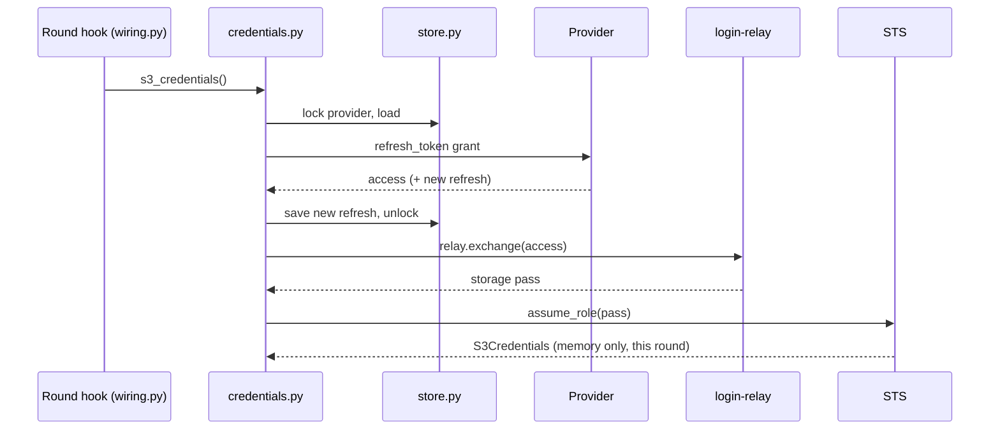

# Login core

Part of the [workspace-admin design](README.md). The login core,
`admin/login/`, is the code that creates, stores, refreshes and removes
[connections](../storage/CONNECT_BACKENDS.md), and verifies browser
sessions. The [`/config` page](CONFIG_PAGE.md), the [CLI](CLI.md) and
nginx are its clients; the round hook in `wiring.py` asks it for
credentials once per round. It talks to the identity provider (GitLab
or Keycloak) and to [login-relay](../auth/LOGIN_RELAY.md). The sign-in
flow itself is described in [Sign-in](SIGN_IN.md).

## Responsibilities

1. Start a sign-in for a provider and return where the user must go.
2. Complete it from the callback: verify `state`, redeem the code with
   the PKCE verifier, run the owner check, store the connection.
3. Hand out fresh credentials each round: refresh, save rotated
   tokens, exchange at login-relay for a storage pass, exchange the
   pass at STS.
4. Disconnect: revoke and delete.
5. Verify browser sessions for nginx (`/_auth`) and `/config`, through
   login-relay.

It never decides which assets exist, never runs `git` or `rclone`,
and imports nothing from `admin/backup`, `admin/git` or `admin/s3`.

## Modules

| Module | Interface | Notes |
| :--- | :--- | :--- |
| `admin/shared.py` (outside `login/`) | `ProviderName`, `OAuthProvider`, `ConnectionState` | Literals shared with `admin/backup`; imports nothing |
| `httpclient.py` | `post_form`, `get_json` with timeouts and size limits | `urllib.request`; failures become `LoginError` |
| `providers.py` | `Provider` (endpoints, scopes, username source); `keycloak()`, `gitlab()` | Authorize on the public URL; token and revoke on the internal one (`OIDC_INTERNAL_URL`, `GITLAB_INTERNAL_URL`) |
| `pkce.py` | `new_verifier()`, `challenge(verifier)` | `secrets`, `hashlib`; S256 |
| `pending.py` | `new_state(username)`, `PendingLogins.add(state, login)`, `take(state, username)` | In memory; single use; 10-minute expiry |
| `flow.py` | `start(provider, username, poll_id=None) -> str`, `complete(provider, code, state, username) -> Connection` | `redirect_uri` is login-relay's bounce address in both calls |
| `owner.py` | `check(provider, identity, main_user)` | Keycloak `preferred_username` from the access token; GitLab `nickname` from `/oauth/userinfo`; `confirm` mode returns "needs confirmation" |
| `store.py` | `Connection`; `load`, `save`, `delete`, `locked(provider)` | `tokens/<provider>.json`; temp file, `fsync`, rename; `0600`; `fcntl` lock |
| `relay.py` | `introspect(token) -> Introspection`, `exchange(token) -> str` | `LOGIN_RELAY_INTERNAL_URL`: `/token/introspect`, `/token/exchange` |
| `sts.py` | `S3Credentials`; `assume_role(pass_jwt, role_arn, seconds) -> S3Credentials` | `AssumeRoleWithWebIdentity`; XML reply parsed with `xml.etree` under a size limit |
| `credentials.py` | `s3_credentials() -> S3Credentials`, `gitlab_access_token() -> str` | Refresh, save rotation, exchange, STS; once per round |
| `session.py` | `verify(access_token) -> str` | `relay.introspect`; returns the username |
| `errors.py` | `LoginError(kind)`, `SessionError` | Kinds below |

All network code uses the standard library, so no runtime dependency
is added.

## Session verification

`session.verify` sends the session's access token (cookie
`dtaas_access_token`, or `Authorization: Bearer`) to login-relay's
`/token/introspect`, the same question Oathkeeper asks. login-relay
answers `active` only for a live token of a session client whose user
is in `WORKSPACE_USERS`; the admin also requires `username ==
MAIN_USER`. Results are cached for 30 seconds by token hash. This works
for opaque GitLab tokens and Keycloak JWTs alike and needs no crypto
library.

nginx calls the same check through `auth_request /_auth` for every
location except `/ping` and the public read-only routes
([threat model](../storage/THREAT_MODEL.md#the-front-door-problem-exists-today)).
`/_auth` answers 204, 401, or 503 when login-relay is unreachable.

## Trusting tokens from the token endpoint

At connect time the admin reads identity from tokens it received
directly from the token endpoint (Keycloak) or from `/oauth/userinfo`
called with them (GitLab). Inside compose those calls are plain HTTP on
`dtaas-users`, which is why dropping `NET_RAW` (or internal TLS) is a
requirement, not a follow-up.

## Credentials for a round

`invalid_grant` becomes `login_expired`; so does a connection older
than `CONNECTION_MAX_AGE_DAYS`, or a lost rotation (the provider has
already revoked the old refresh token). The stored file is kept so the
page can show who was connected; signing in again replaces it.

## Disconnect

Lock, load, call the revocation endpoint (failure logged, not fatal),
delete the file, unlock, drop pending sign-ins for that provider.

## Error kinds

| Kind | Meaning | Status kind ([list](../storage/CONNECT_BACKENDS.md#status-kinds)) |
| :--- | :--- | :--- |
| `provider_unreachable` | Provider, login-relay or STS unreachable | `login_unreachable` or `s3_unreachable` |
| `login_denied` | User declined consent | none; page shows "not connected" |
| `login_timeout` | Pending sign-in expired | none; start again |
| `state_invalid` | Unknown, used, expired or other user's `state` | none; start again |
| `owner_mismatch` | Token belongs to another user; both names shown | none; sign in as `MAIN_USER` |
| `login_expired` | Refresh rejected, or connection too old | `login_expired` |
| `exchange_denied` | login-relay refused the storage pass | `s3_auth_failed` |
| `sts_denied` | STS refused the pass | `s3_auth_failed` |

Messages never include tokens, codes or provider response bodies.

## Testing

- Unit: PKCE vectors from RFC 7636; `state` format; pending sign-in
  expiry, single use and username binding; store atomicity (kill
  between write and rename); rotation saved before use; lock prevents
  disconnect and refresh races; 503 when login-relay is down.
- Fakes: `tests/helpers/fake_idp.py` (Keycloak and GitLab endpoints
  including `/oauth/userinfo`), `tests/helpers/fake_relay.py`
  (`/token/introspect`, `/token/exchange`), `tests/helpers/fake_sts.py`.
- Integration: real login-relay, Keycloak and SeaweedFS; the browser
  step replaced by Keycloak's password grant in tests only; the GitLab
  profile against login-relay's GitLab fake.
