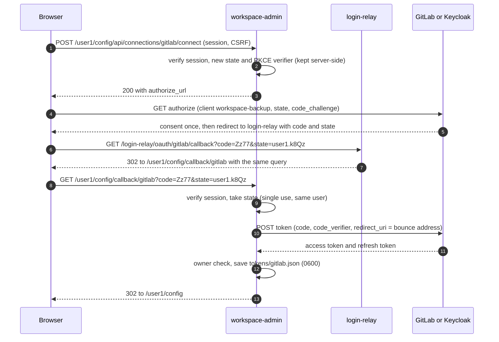
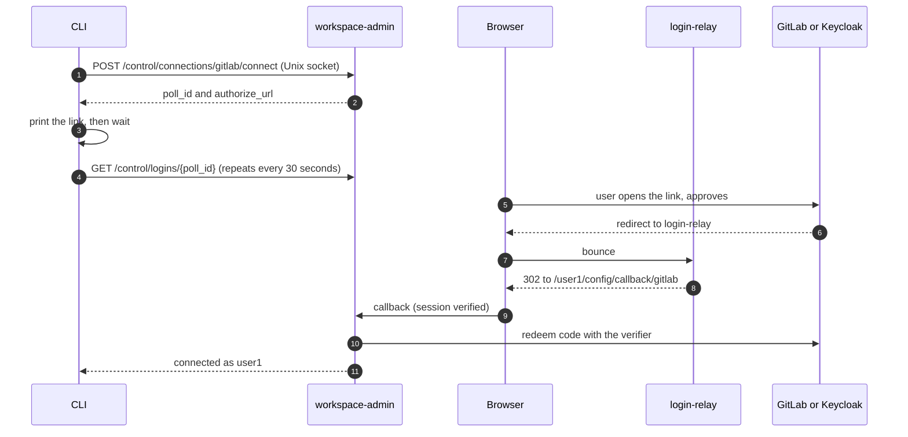

# Direct PKCE sign-in for workspace-admin

Part of the [workspace-admin design](README.md). How workspace-admin
gets its own tokens from GitLab or Keycloak, started from the
[`/config` page](CONFIG_PAGE.md) or the [CLI](CLI.md). Provider-specific
walk-throughs: [STORAGE_GITLAB](../storage/STORAGE_GITLAB.md#step-4-connecting-backups)
and [STORAGE_KEYCLOAK](../storage/STORAGE_KEYCLOAK.md#step-4-connecting-s3-backups).

## In short

The DTaaS login cookie belongs to login-relay and lasts minutes to two
hours, so it cannot drive backups. workspace-admin therefore signs in
**directly** as its own OAuth client, `workspace-backup`:

- workspace-admin creates the PKCE secret, builds the authorize URL,
  redeems the code and keeps the tokens;
- the user approves in their own DTaaS browser (not the VNC desktop),
  where the provider session usually makes it one click;
- login-relay only forwards the browser from one shared return address
  to the right workspace. It never sees the PKCE secret, so it cannot
  redeem the code.

| Provider | Client | Scopes | Grant kept |
| :--- | :--- | :--- | :--- |
| GitLab | Public application `workspace-backup` | `openid write_repository` | Refresh token, no fixed expiry |
| Keycloak | Public client `workspace-backup`, consent required | `openid offline_access` | Offline refresh token, 30 days idle, 180 days at most |

## Started from the page



The token request in step 10:

```http
POST /oauth/token HTTP/1.1
Host: gitlab.example.org
Content-Type: application/x-www-form-urlencoded

grant_type=authorization_code&code=Zz77
&redirect_uri=https%3A%2F%2Fdtaas.example.org%2Flogin-relay%2Foauth%2Fgitlab%2Fcallback
&client_id=<workspace-backup uid>&code_verifier=<43 to 128 characters>
```

`redirect_uri` is login-relay's bounce address in both the authorize
and the token request; providers reject the code if the two differ.

## Started from the CLI



The CLI's own request proves nothing about identity; the socket is
owner-only, so the pending sign-in is bound to `MAIN_USER`, and the
callback must still arrive with a verified browser session for that
user.

## state and PKCE

| Item | Rule |
| :--- | :--- |
| `state` | `<username>.<random>`; `random` is 32 bytes from `secrets`, base64url without padding (43 characters, no dot); parsers split on the last dot |
| PKCE verifier | 32 bytes from `secrets`, base64url (43 characters); challenge `S256` |
| Pending sign-in | Kept in memory with provider, verifier, username, optional `poll_id`; single use; 10 minutes |
| Binding | `take(state, username)` refuses unknown, used, expired or other-user `state` |

## After sign-in

- **Owner check:** the provider's username must equal `MAIN_USER`
  (Keycloak `preferred_username`, GitLab `nickname`); a mismatch stores
  nothing and names both users. With `GITLAB_OWNER_CHECK=confirm` the
  page or CLI shows the account and stores only after confirmation.
- **Stored connection** (`tokens/gitlab.json`, mode `0600`):

  ```json
  {"provider": "gitlab", "subject": "user1",
   "obtained_at": "2026-10-17T09:00:00Z",
   "secret": {"refresh_token": "<opaque>"}}
  ```

- **Each round:** refresh, save a rotated refresh token before using
  the access token, then exchange ([Login core](LOGIN_CORE.md)).
- **Reconnect:** a rejected refresh, or a connection older than
  `CONNECTION_MAX_AGE_DAYS` (180), reports `login_expired`; signing in
  again replaces the file.
- **Disconnect:** revoke, then delete. GitLab, from a public client:

  ```http
  POST /oauth/revoke HTTP/1.1
  Host: gitlab.example.org
  Content-Type: application/x-www-form-urlencoded

  token=<refresh token>&client_id=<workspace-backup uid>
  ```

## Failures

| Failure | Page or CLI shows | Stored |
| :--- | :--- | :--- |
| User cancels at the provider | "Not connected" | Nothing |
| Sign-in took over 10 minutes, or the link was reused | "Start again" | Nothing |
| Provider account is another user | "Sign in as user1 (you are user2)" | Nothing |
| `state` names an unlisted user | login-relay answers 403 | Nothing |
| Browser session expired before the callback | Oathkeeper sends the user through login, then the callback continues | Connection, once the callback arrives |
| Provider or login-relay unreachable | "GitLab unavailable, try later" | Nothing |
| Git asset unreachable with the new token | Connected, with `repo_unreachable` on that asset | Connection |

## Why this design

| Alternative | Why not |
| :--- | :--- |
| Reuse the DTaaS login cookie | Belongs to login-relay's client, lasts at most two hours, cannot be refreshed by the workspace |
| Loopback redirect to `127.0.0.1` | The browser runs outside the container |
| A redirect URI per user | Providers need exact URIs; adding a user would change the registration |
| login-relay redeems the code | It would hold every user's long-lived grant |
| Device flow | Needs no callback, but GitLab supports it only in recent releases; kept as a follow-up |

Security controls for these routes are in the
[storage threat model](../storage/THREAT_MODEL.md#protection-layers-for-the-config-page-and-control-socket).
