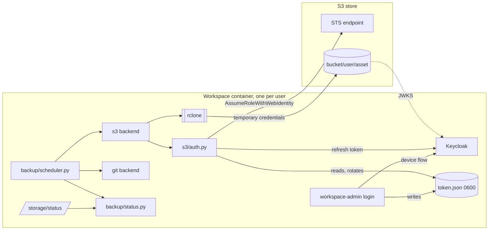

# Plan: S3 object storage backup for workspace files

Implements [the spec](../specs/102-s3-backup.md). Tasks are in
[the task list](../tasks/102-s3-backup.md).

## Current state

`workspace-admin` runs inside every workspace container, one process
per user. Its git backup lives in `workspaces/src/admin/src/admin/git/`:

| Module | Role | Coupling to git |
| :--- | :--- | :--- |
| `bootstrap.py` | Loads config, clones, starts the scheduler | Calls git clone directly |
| `scheduler.py` | Runs `sync_once(repo)` per interval | Takes `RepoConfig`, imports `sync_once` |
| `status.py` | Thread-safe outcome per repository | Imports `SyncErrorKind` from `git.sync` |
| `sync.py` | Commit, pull, push (920 lines) | Git only |
| `config.py` | Parses `[assets.*]` into `RepoConfig` | Requires `GIT_*` keys |
| `runner.py` | Runs one git command with a time limit | Git environment only |

`main.py` calls `start_git_backup`; `api.py` serves
`SyncStatus.snapshot()` at `/storage/status`. `sync.py` already
exceeds the 250-line limit; that is out of scope and not grown here.

## Architecture



### Backend interface

A new package `admin/backup/` holds what is not git- or S3-specific:

```python
class Backend(Protocol):
    name: str                                   # asset name
    def prepare(self, stop_event) -> None: ...  # clone, or check bucket
    def sync(self, stop_event) -> None: ...     # one backup round
```

- `backup/errors.py`: `BackupErrorKind` (today's `SyncErrorKind`
  values plus the new kinds), `BackupError`, `BackupStopped`.
  `git/sync.py` re-exports the old names.
- `backup/status.py`: today's `SyncStatus`, grouped by backend type.
- `backup/scheduler.py`: today's loop over `list[Backend]`.
- `backup/bootstrap.py`: builds one backend per asset, calls
  `prepare`, starts the scheduler.
- `git/backend.py`: `GitBackend` wraps `clone_asset` and `sync_once`.

### Configuration

Deployment-wide settings come from the environment, set once in
compose for every workspace:

| Variable | Example (SeaweedFS) | Example (AWS) |
| :--- | :--- | :--- |
| `BACKUP_BACKEND_DEFAULT` | `s3` | `s3` |
| `S3_ENDPOINT` | `http://seaweedfs:8333` | `https://s3.eu-north-1.amazonaws.com` |
| `S3_REGION` | `us-east-1` | `eu-north-1` |
| `S3_BUCKET` | `dtaas-backup` | `dtaas-backup` |
| `S3_PROVIDER` (rclone) | `SeaweedFS` | `AWS` |
| `S3_AUTH` | `oidc` | `oidc` |
| `S3_STS_ENDPOINT` | `http://seaweedfs:8333` | `https://sts.eu-north-1.amazonaws.com` |
| `S3_ROLE_ARN` | `arn:seaweed:iam::role/WorkspaceBackup` | the IAM role ARN |
| `OIDC_ISSUER` | `https://<server>/auth/realms/dtaas` | same |
| `OIDC_CLIENT_ID` | `workspace-backup` | same |

A `config.toml` section may override per asset, for example
`BACKUP_BACKEND = "git"` to keep one asset on git. In `keys` mode the
section carries `S3_ACCESS_KEY` and `S3_SECRET_KEY`, marked
`repr=False` like `RepoConfig.token`. The object prefix is derived,
never configured: `<MAIN_USER>/<asset>/`, or `common/`.

### S3 backend (`admin/s3/`)

| Module | Role |
| :--- | :--- |
| `config.py` | Merge environment and section; validate |
| `oidc.py` | Device flow, refresh, revoke; Keycloak endpoints from the issuer's discovery document |
| `token_store.py` | Read and atomically replace `token.json` (`0600`, write then rename) |
| `sts.py` | `AssumeRoleWithWebIdentity` over HTTPS, parse the XML reply |
| `auth.py` | One call per round: stored token to temporary credentials, or static keys |
| `runner.py` | Run `rclone` with a time limit and stop event |
| `errors.py` | Map HTTP, STS and `rclone` failures to kinds; redact secrets |
| `backend.py` | `S3Backend.prepare` and `S3Backend.sync` |

All HTTP uses `urllib.request` with timeouts, so no dependency is
added. Credentials reach `rclone` only as environment variables
(`RCLONE_CONFIG_BACKUP_ACCESS_KEY_ID`, `..._SECRET_ACCESS_KEY`,
`..._SESSION_TOKEN`, `..._ENDPOINT`, `..._PROVIDER`); no
`rclone.conf` is written.

**prepare** checks the bucket exists and versioning is `Enabled`.
**sync** first refuses an empty or missing work tree, then runs
`rclone sync <work_tree> backup:<bucket>/<prefix>` with `--exclude`
for both admin directories, `--fast-list`, `--max-delete` and
connection and I/O timeouts.

### Login

`workspace-admin login` and `logout` become subcommands next to
today's flags, so `workspace-admin` with no subcommand still serves.

1. Fetch the issuer's discovery document; POST to the device
   authorization endpoint with `client_id` and
   `scope=openid offline_access`.
2. Print the verification link and user code; open the link with
   `xdg-open` in the workspace desktop.
3. Poll the token endpoint at the returned interval until approved,
   denied or expired.
4. Decode the access token's claims (no signature check is needed
   for this local comparison; SeaweedFS verifies the signature) and
   refuse unless `preferred_username == MAIN_USER`.
5. Store the refresh token via `token_store`.

The service never calls the login code. It only reads the file, so
no inter-process channel and no HTTP route is needed.

### Keycloak client

`workspace-backup`: public client, OAuth 2.0 device authorization
grant on, standard flow off, `offline_access` allowed, an audience
mapper for `workspace-backup`, and `preferred_username` in the access
token. Refresh-token rotation is supported but not required.

### SeaweedFS service and IAM

A single `weed server -s3` container, version 4.40 or later:

- `users` (`dtaas-users`) network only; no `ports:`; no labels.
- One persistent volume at `/data` (contents, filer LevelDB, master
  metadata). Docs recommend a disk other than `./files/`.
- `-s3.config` holds the provisioning admin identity only.
- `-s3.iam.config` holds the Keycloak provider (issuer as in tokens,
  `jwksUri` on the internal Keycloak address), the role
  `WorkspaceBackup` trusting that provider for
  `AssumeRoleWithWebIdentity`, and its policy:
  read, write and list on `<bucket>/${jwt:preferred_username}/*` and
  `<bucket>/common/*`, list on the bucket limited by `s3:prefix`.

On AWS the same policy is written with
`${aws:PrincipalTag/username}`, fed from a Keycloak session-tag
mapper; that is configuration, not admin code.

### Provisioning (DTaaS)

A one-shot compose service (profile `provision`) beside
`deploy/dtaas/docker/secure-server/`, idempotent:

1. Create the bucket, enable versioning, apply the lifecycle rule.
2. Write the two SeaweedFS config files from templates.
3. Create or update the Keycloak client through the admin REST API.

It holds the SeaweedFS and Keycloak admin credentials; workspace
containers receive neither. It touches no user's files.

### Status

`/storage/status` keeps its shape; when an S3 asset exists, a sibling
`s3` key is added with the same per-asset fields. Without S3 assets
the response is byte-identical to today's.

### Restore

A runbook in `DOCUMENTATION.md`. The operator obtains credentials
for the user's prefix (an admin identity), then:

```bash
rclone copy --s3-version-at "2026-10-16 09:00" \
  backup:dtaas-backup/user1/private ./restore/private
```

The integration test runs exactly these commands.

## Testing

| Level | What | How |
| :--- | :--- | :--- |
| Unit | Config merge, error mapping, runner, backend calls | Fake `rclone` on `PATH`, like `tests/helpers/fake_git.py` |
| Unit | Device flow, refresh, rotation, owner check, STS parsing | A local `http.server` fake Keycloak and STS |
| Unit | Refactor safety | Existing tests pass; only import paths change |
| Unit | No secrets | Tokens and keys absent from caplog, status and the fake's argv |
| Integration | Round-trip and isolation | Keycloak and SeaweedFS containers: login by password grant in test, sync, delete, restore, cross-user `AccessDenied`, revoke |
| Compose | Network | Host cannot reach S3; workspace can |

## Delivery: six pull requests

The issue proposed five; login and STS are split from the S3 backend
so each stays reviewable.

| PR | Repository | Content | Depends on |
| :--- | :--- | :--- | :--- |
| 1 | workspace | SeaweedFS in `workspaces/test/dtaas` compose files | spike |
| 2 | workspace | `admin/backup/` refactor, no behaviour change | none |
| 3 | workspace | S3 backend in `keys` mode, `rclone` in the image | 2 |
| 4 | workspace | `oidc` mode: login, token store, STS | 3 |
| 5 | DTaaS | Provisioning: bucket, SeaweedFS IAM, Keycloak client | 1 |
| 6 | DTaaS | secure-server integration, docs, runbook | 4, 5 |

PRs 1 and 2 can be developed in parallel.

## Risks

| Risk | Mitigation |
| :--- | :--- |
| SeaweedFS OIDC, policy variables and lifecycle on versioned buckets are recent | Spike T001 verifies all three on the pinned release |
| SeaweedFS rejects split issuer and JWKS addresses | Spike T003; fallback is resolving the public name to Traefik on `dtaas-users` |
| `rclone sync` with an empty work tree deletes the backup | Refuse empty or missing trees; `--max-delete` |
| Workspace stopped beyond the offline-session idle time | Status reports `login_expired`; user logs in again |
| Refresh-token rotation interrupted mid-write | Write then rename; keep the old file until the new one is complete |
| Single SeaweedFS on the same disk as the files | Documented; recommend separate disk, host or cloud |
| Refactor breaks the git backup | PR 2 changes no behaviour; counts compared against `main` |
