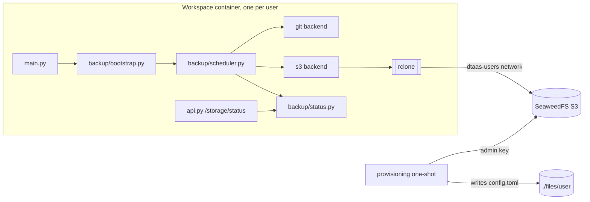

# Plan: S3 object storage backup for workspace files

Implements [spec.md](spec.md). Tasks are in [tasks.md](tasks.md).

## Current state

`workspace-admin` runs inside every workspace container, one process
per user. Its git backup is built from these modules in
`workspaces/src/admin/src/admin/git/`:

| Module | Role | Coupling to git |
| :--- | :--- | :--- |
| `bootstrap.py` | Loads config, clones, starts the scheduler | Calls git clone directly |
| `scheduler.py` | Runs `sync_once(repo)` per interval | Takes `RepoConfig`, imports `sync_once` |
| `status.py` | Thread-safe outcome per repository | Imports `SyncErrorKind` from `git.sync` |
| `sync.py` | Commit, pull, push (920 lines) | Git only |
| `config.py` | Parses `[assets.*]` into `RepoConfig` | Requires `GIT_*` keys |
| `runner.py` | Runs one git command with a time limit | Git environment only |

`main.py` calls `start_git_backup` and `stop_git_backup`. `api.py`
serves `SyncStatus.snapshot()` at `/storage/status`.

`sync.py` already exceeds the 250-line limit. That is pre-existing
and out of scope here; this work does not grow it.

## Architecture



### Backend interface

A new package `admin/backup/` holds everything that is not specific
to git or S3:

```python
class Backend(Protocol):
    name: str                      # asset name, e.g. "private"
    def prepare(self, stop_event) -> None: ...   # clone, or check bucket
    def sync(self, stop_event) -> None: ...      # one backup round
```

- `backup/errors.py`: `BackupErrorKind` (today's `SyncErrorKind`
  values plus the S3 kinds), `BackupError`, `BackupStopped`.
  `git/sync.py` re-exports the old names so nothing else changes.
- `backup/status.py`: today's `SyncStatus`, keyed by asset name and
  grouped by backend type.
- `backup/scheduler.py`: today's loop over `list[Backend]`.
- `backup/bootstrap.py`: reads `config.toml` once, builds one backend
  per asset, calls `prepare`, then starts the scheduler.
- `git/backend.py`: `GitBackend` wraps `clone_asset` and `sync_once`.
- `s3/`: the new backend (below).

### Configuration

The same `[assets.<name>]` sections, plus a selector. Existing files
need no edit because `git` is the default.

```toml
[assets.private]
BACKUP_BACKEND = "s3"
S3_ENDPOINT = "http://seaweedfs:8333"
S3_BUCKET = "user1"
S3_PREFIX = "private"          # optional
S3_ACCESS_KEY = "..."
S3_SECRET_KEY = "..."
```

`S3Config` is a dataclass with both keys marked `repr=False`, as
`RepoConfig.token` is. Validation mirrors the git checks: required
keys, placeholder values refused, endpoint must be `http(s)://`, and
the work tree may not contain the config file.

### S3 backend (`admin/s3/`)

| Module | Role |
| :--- | :--- |
| `config.py` | Parse and validate an S3 asset section |
| `runner.py` | Run `rclone` with a time limit and stop event, mirroring `git/runner.py` |
| `errors.py` | Map `rclone` exit codes and stderr to error kinds |
| `backend.py` | `S3Backend.prepare` and `S3Backend.sync` |

- **Credentials** go to `rclone` as environment variables
  (`RCLONE_CONFIG_BACKUP_TYPE=s3`, `..._ACCESS_KEY_ID`,
  `..._SECRET_ACCESS_KEY`, `..._ENDPOINT`, `..._PROVIDER=SeaweedFS`).
  They never appear in argv and there is no `rclone.conf` on disk.
- **prepare** checks that the bucket exists and versioning is
  `Enabled` (`rclone backend versioning backup:<bucket>`). Failure
  sets `s3_bucket_missing` or `s3_versioning_disabled`, and the
  backend stays registered so the next round retries.
- **sync** runs `rclone sync <work_tree> backup:<bucket>/<prefix>`
  with `--exclude` for both admin directories, `--fast-list`,
  `--max-delete` and a `--contimeout` and `--timeout` below the
  runner's limit. Deletions propagate, and versioning keeps them
  recoverable.
- **Error mapping**: exit codes and recognised stderr lines map to
  kinds. Only the kind reaches status; the full message goes to the
  log after secrets are redacted.

### Status

`/storage/status` keeps its current shape. When at least one asset
uses S3, a sibling key is added:

```json
{"enabled": true,
 "repositories": {"common": {...}},
 "s3": {"private": {"last_attempt": "...", "last_success": "...",
                    "last_error": null}}}
```

Without S3 assets the response is byte-identical to today's, which
acceptance criterion 3 checks.

### SeaweedFS service

A single-container SeaweedFS (`weed server -s3`) in compose:

- Networks: `users` (`dtaas-users`) only.
- No `ports:` and no Traefik labels.
- A named volume for data.
- `-s3.config=/etc/seaweedfs/s3.json` with the admin identity only,
  mounted from a file generated by provisioning, mode `0600`.
- A healthcheck on the S3 port.

The image tag is pinned to a release that enforces lifecycle rules
on versioned buckets; task T001 picks it.

### Provisioning

A one-shot compose service (profile `provision`) in the DTaaS
repository, beside `deploy/dtaas/docker/secure-server/`. For each
user in the user list and for `common`:

1. Create the bucket if missing, enable versioning, apply the
   noncurrent-version lifecycle rule.
2. Create the identity with `Read`, `Write`, `List` and `Tagging`
   scoped to that bucket (`Read:user1`) through `weed shell`, and the
   same scoped access to `common`.
3. Write `config.toml` into `./files/<user>/.config/workspace-admin/`
   with mode `0600` and the workspace user's uid, keeping any
   existing git sections. An existing S3 key is reused, not rotated.

### Restore

A runbook in `DOCUMENTATION.md`, run by an operator from any
container on `dtaas-users` with the user's key:

```bash
rclone copy --s3-version-at "2026-10-16 09:00" \
  backup:user1/private ./restore/private
```

A single path is restored the same way with a narrower source. The
integration test runs exactly these commands.

## Testing

| Level | What | How |
| :--- | :--- | :--- |
| Unit | S3 config parsing, error mapping, runner timeouts, backend calls | Fake `rclone` script on `PATH`, like `tests/helpers/fake_git.py` |
| Unit | Refactor safety | Every existing test passes; only import paths change |
| Unit | No secrets | Assert keys absent from caplog, status JSON and the fake's argv |
| Integration | Real round-trip | SeaweedFS container in CI: sync, delete, restore, version check; skipped when Docker is absent |
| Compose | Isolation | `test-compositions.yml`: host cannot reach S3, workspace can; cross-user `AccessDenied` |

## Delivery: five pull requests

| PR | Repository | Content | Depends on |
| :--- | :--- | :--- | :--- |
| 1 | workspace | SeaweedFS in `workspaces/test/dtaas` compose files | T001 spike |
| 2 | workspace | `admin/backup/` refactor, git as one backend, no behaviour change | none |
| 3 | workspace | `admin/s3/` backend, `rclone` in the image, docs | 2 |
| 4 | DTaaS | Provisioning one-shot service | 1 |
| 5 | DTaaS | secure-server integration, docs, restore runbook | 3, 4 |

PRs 1 and 2 can be developed in parallel.

## Risks

| Risk | Mitigation |
| :--- | :--- |
| SeaweedFS lifecycle on versioned buckets is recent | T001 verifies on the pinned release; fallback is a scheduled `rclone delete --min-age` on old versions |
| `rclone sync` deletes everything if the work tree is empty (unmounted volume) | Refuse to sync an empty or missing work tree, and use `--max-delete` as a guard |
| All workspaces share `dtaas-users` | Isolation rests on scoped identities; covered by the cross-user test |
| Full listing every interval on large trees | `--fast-list`; measure before tuning the interval |
| Host file ownership of generated `config.toml` | Provisioning sets the uid; tested in PR 4 |
| Refactor breaks the git backup | PR 2 changes no behaviour; test counts compared against `main` |
